# ghostless gallery

Every card is the same fictional client (Lodos, a coffee roastery by the Karaköy ferry pier) in a
different style or with a different move, so the differences are easy to see. Run it live with
`node scripts/gallery.mjs` to mark what you like and what you never want.

Her kart aynı hayali kahve dükkânının farklı bir stilde ya da farklı bir hareketle hazırlanmış hali.
Canlı görmek ve seçim yapmak için: `node scripts/gallery.mjs`.

## Görsel stiller · Visual styles

Her yön bir stilden yola çıkar. Beğendiklerini seç, hiç istemediklerini işaretle.

### Editoryal / dergi · Editorial / magazine

Serif başlıklar, sütunlar, alıntılar, büyük fotoğraf. Uyar: otel, restoran, medya, holding.

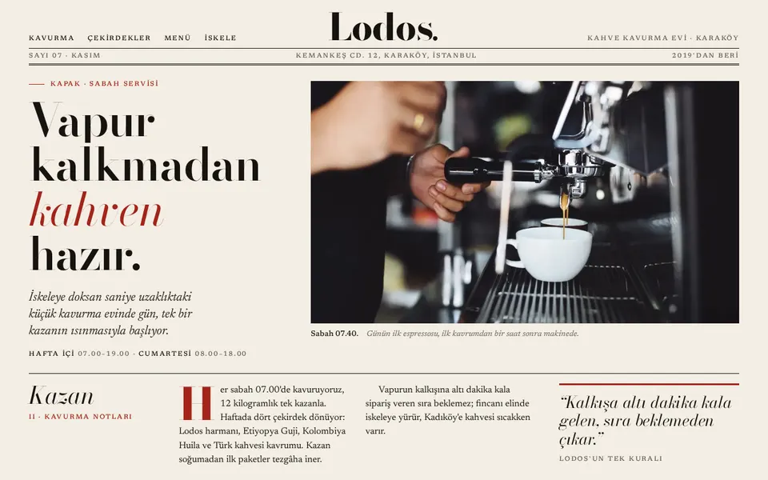

Demo: [`demos/styles/editorial.html`](demos/styles/editorial.html)

### İsviçre / uluslararası · Swiss / International

Katı ızgara düzeni, sola yaslı grotesk, büyük sayılar, az renk. Uyar: mimarlık, danışmanlık, kurum.

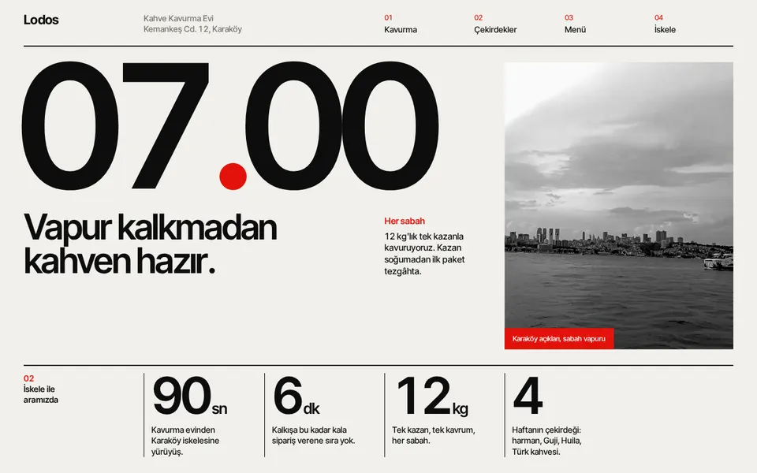

Demo: [`demos/styles/swiss.html`](demos/styles/swiss.html)

### Endüstriyel / kullanım kılavuzu · Industrial / product manual

Keskin köşe, nesne fotoğrafı, mono detaylar, tek sinyal rengi. Uyar: donanım, alet, ses, mühendislik.

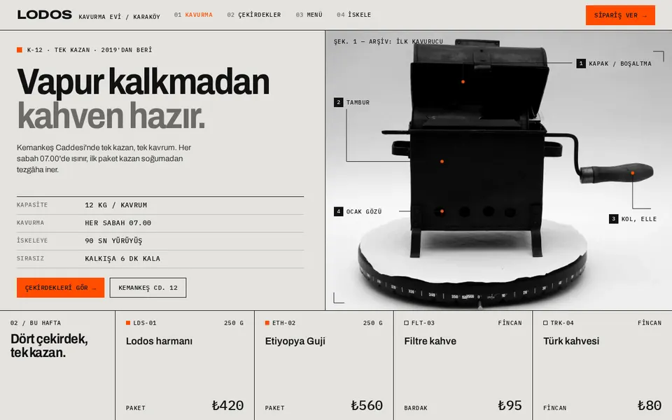

Demo: [`demos/styles/industrial.html`](demos/styles/industrial.html)

### Neo-brütalizm · Neo-brutalism

Kalın siyah kenar, sert gölge, düz ve bağıran renkler. Uyar: üretici araçları, bağımsız yazılım.

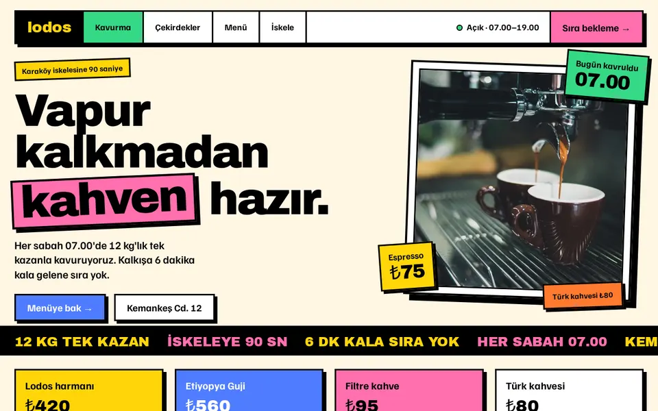

Demo: [`demos/styles/neo-brutalism.html`](demos/styles/neo-brutalism.html)

### Kinetik tipografi · Kinetic typographic

Görselin yerini yazı alır, anlamı hareket taşır. Uyar: kampanya, müzik, etkinlik.

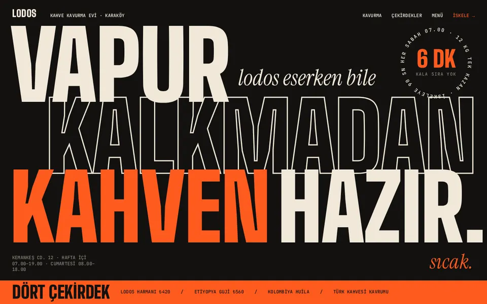

Demo: [`demos/styles/kinetic-type.html`](demos/styles/kinetic-type.html)

### Kaydırarak anlatım · Scrollytelling

Yanındaki metinle değişen sabit görsel ya da grafik. Uyar: rapor, süreç anlatımı, araştırma.

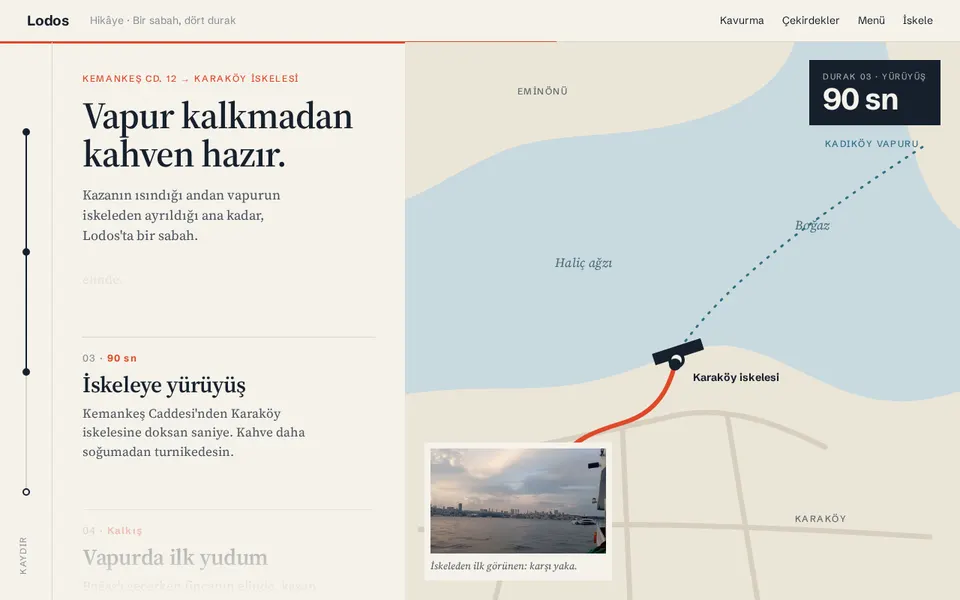

Demo: [`demos/styles/scrollytelling.html`](demos/styles/scrollytelling.html)

### Fotoğraf öncelikli belgesel · Photo-led documentary

Tam ekran gerçek fotoğraf, çok az arayüz, alt yazılar. Uyar: yerel işletme, otel, dernek.

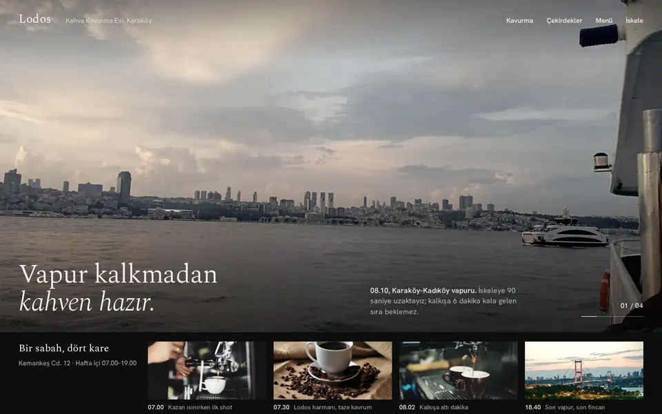

Demo: [`demos/styles/photo-documentary.html`](demos/styles/photo-documentary.html)

### Risograf / baskı · Risograph / print

Üst üste basılmış 2–3 mürekkep, kayık baskı, gren. Uyar: fanzin, festival, kafe, kitapçı.

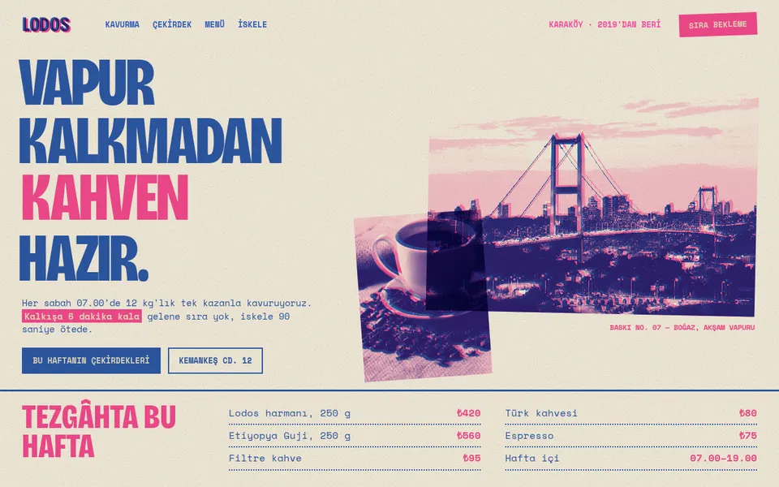

Demo: [`demos/styles/risograph.html`](demos/styles/risograph.html)

### Dither / 1-bit · Dithered / 1-bit

İki renkli noktalı görseller, eski ekran dokusu. Uyar: karakterli teknoloji, arşiv.

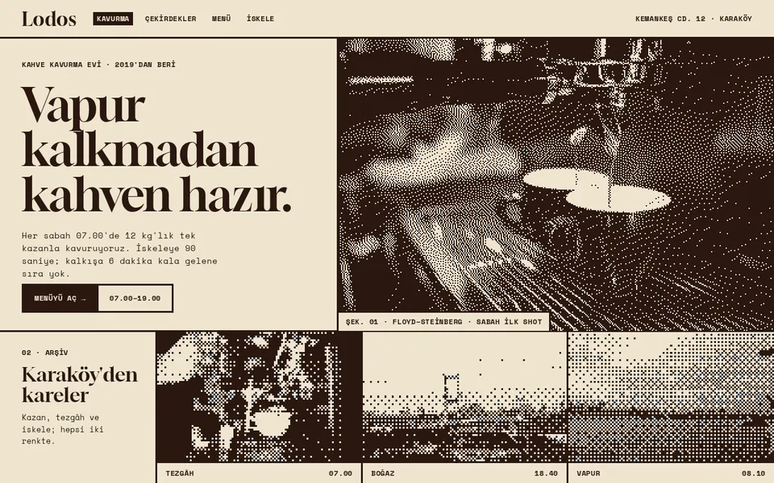

Demo: [`demos/styles/dithered.html`](demos/styles/dithered.html)

### Piksel art / 8-bit · Pixel art / 8-bit

Piksel çizimler, kalın piksel yazı, adım adım hareket. Uyar: oyun, çocuk, retro.

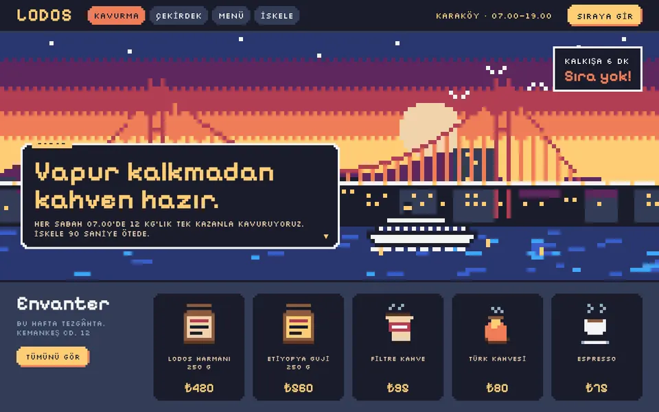

Demo: [`demos/styles/pixel-art.html`](demos/styles/pixel-art.html)

### Terminal / ASCII · Terminal / ASCII

Mono yazı, komut satırı arayüzü, karakterlerden görsel. Uyar: yazılım araçları, altyapı, güvenlik.

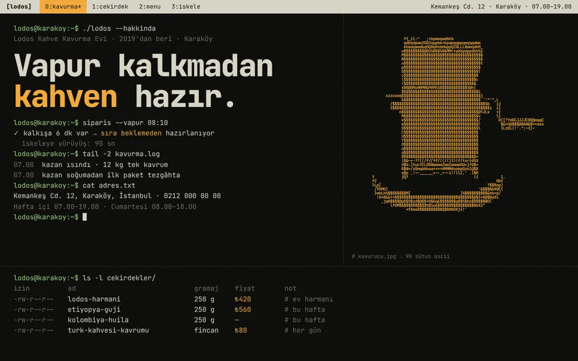

Demo: [`demos/styles/terminal.html`](demos/styles/terminal.html)

### Eski işletim sistemi · Retro OS

Pencere çerçeveleri, masaüstü düzeni, piksel yazılar. Uyar: müzik, nostalji, eğlenceli ürün.

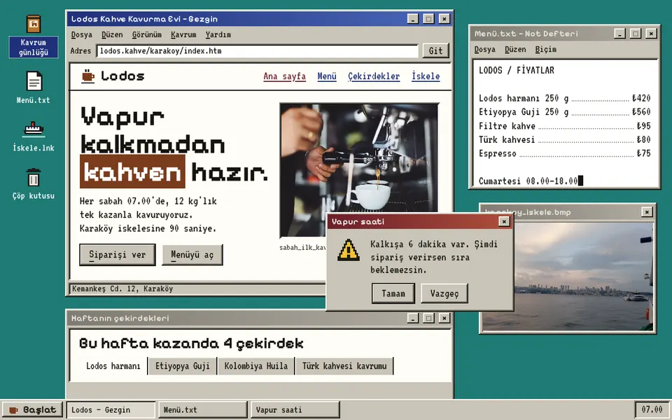

Demo: [`demos/styles/retro-os.html`](demos/styles/retro-os.html)

### Gerçek malzeme (skeuomorfik) · Skeuomorphic revival

Dokulu malzemeler, gerçek düğmeler ve kadranlar. Uyar: ses, donanım, lüks.

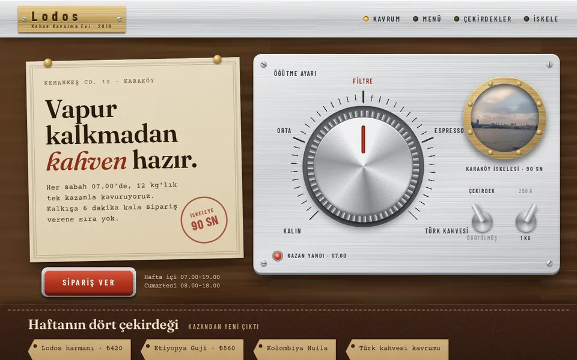

Demo: [`demos/styles/skeuomorphic.html`](demos/styles/skeuomorphic.html)

### Kolaj / karalama defteri · Collage / scrapbook

Yırtık kâğıt, bant, kesilmiş fotoğraf, el yazısı. Uyar: yemek, seyahat, kişisel marka.

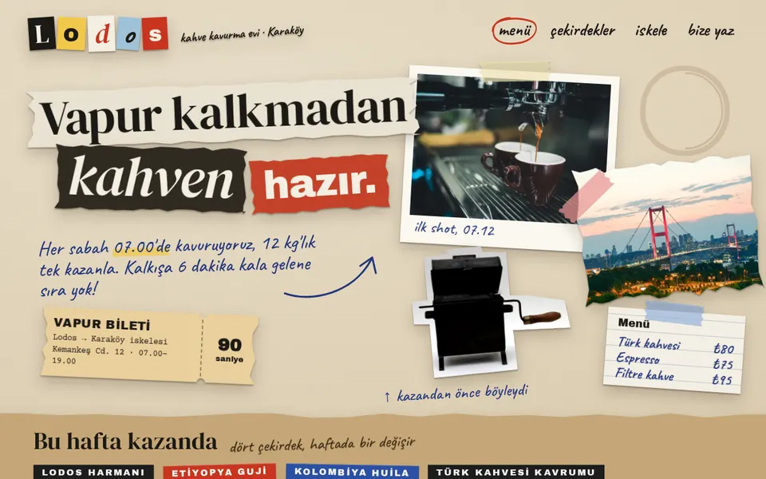

Demo: [`demos/styles/collage.html`](demos/styles/collage.html)

### Memphis · Memphis

Kıvrımlar, konfeti şekilleri, çatışan pastel ve canlı renkler. Uyar: çocuk, etkinlik, eğlenceli perakende.

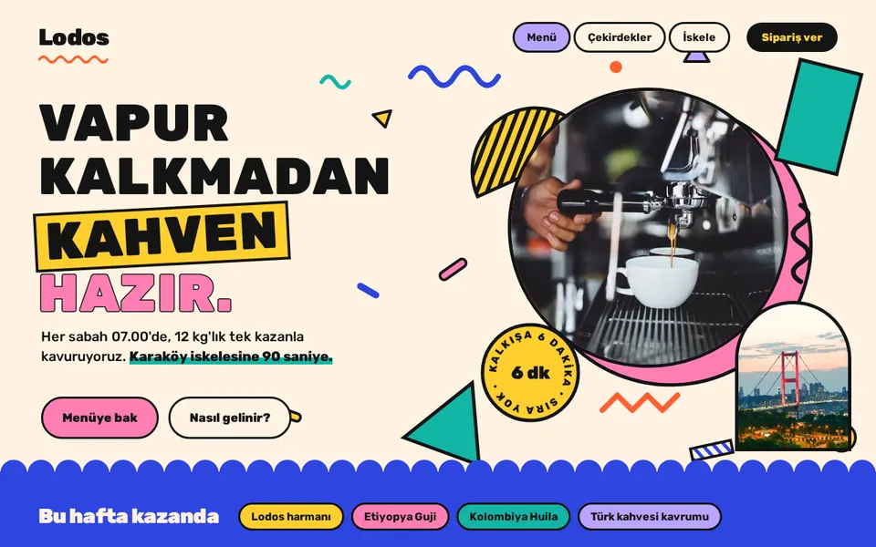

Demo: [`demos/styles/memphis.html`](demos/styles/memphis.html)

### Maksimalist · Maximalist

Yoğun katmanlar, çatışan desenler, çok yazı tipi. Uyar: moda, kültür, gece hayatı.

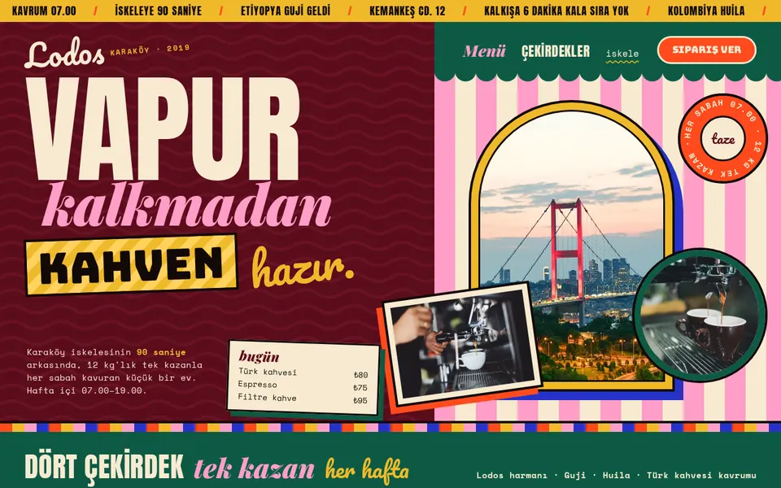

Demo: [`demos/styles/maximalist.html`](demos/styles/maximalist.html)

### Organik / kuralsız · Organic / anti-design

Düzensiz yerleşim, el çizimi, doğal formlar. Uyar: sağlıklı yaşam, el işi.

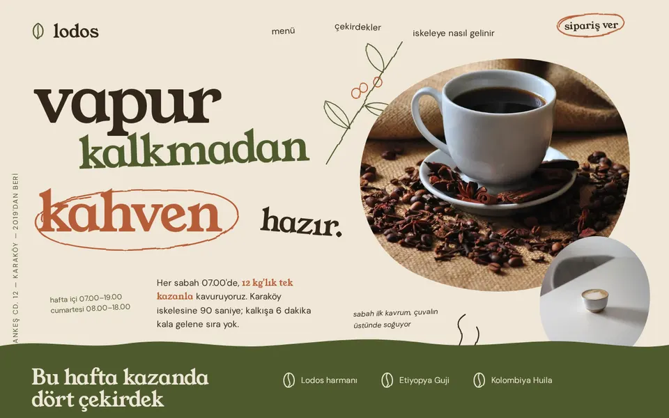

Demo: [`demos/styles/organic.html`](demos/styles/organic.html)

### İllüstrasyonlu / maskotlu · Illustrated / mascot-led

Tek elden çıkmış çizim sistemi, karakterler. Uyar: uygulama, çocuk, tanıtım akışı.

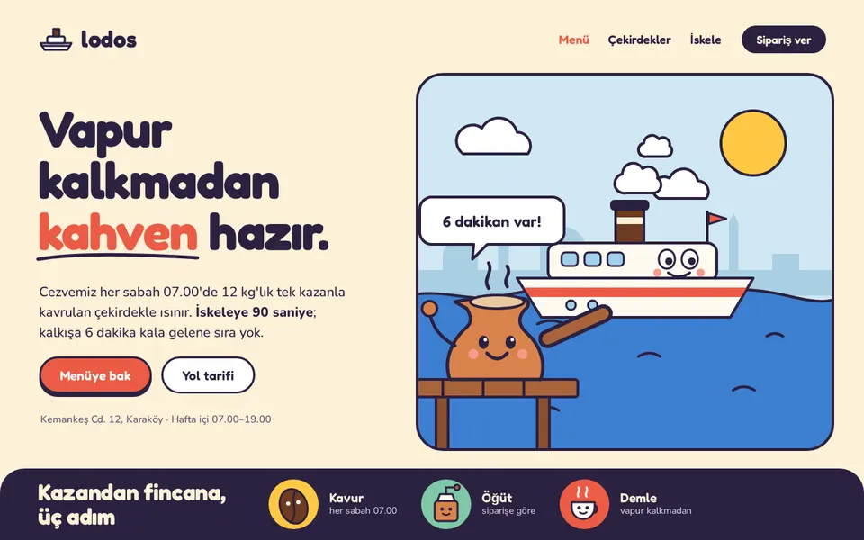

Demo: [`demos/styles/illustrated.html`](demos/styles/illustrated.html)

### Lüks sade · Luxury minimal

Çok boşluk, ince serif, tek büyük görsel, ağır ve sakin. Uyar: mücevher, otel, parfüm, gayrimenkul.

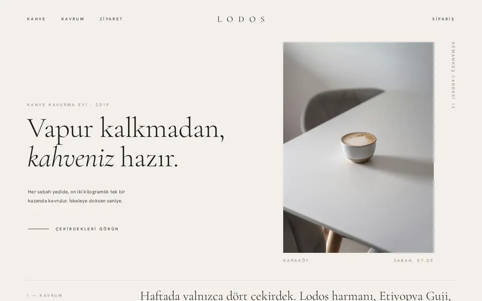

Demo: [`demos/styles/luxury-minimal.html`](demos/styles/luxury-minimal.html)

### Bauhaus · Bauhaus ⚠

Ana renkler, daire-kare-üçgen, geometrik yazı. Uyar: tasarım okulu, eğitim (cetvelle çizilmiş geometri sık reddedilir).

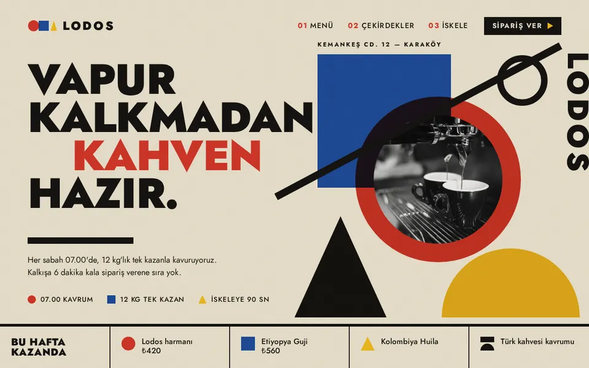

Demo: [`demos/styles/bauhaus.html`](demos/styles/bauhaus.html)

### Y2K / krom · Y2K / chrome ⚠

Sıvı krom, kabarcıklı yazı, yanardöner yüzeyler. Uyar: moda, müzik (parıltı ve gradyana kayar).

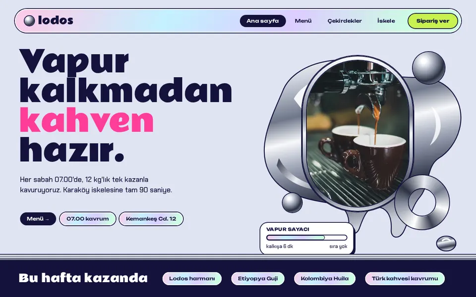

Demo: [`demos/styles/y2k-chrome.html`](demos/styles/y2k-chrome.html)

### Bento ızgara · Bento grid ⚠

Farklı boyda kutulardan oluşan ızgara. Uyar: yalnız içerik gerçekten modülerse (yapay zekâ sitelerinin varsayılanı).

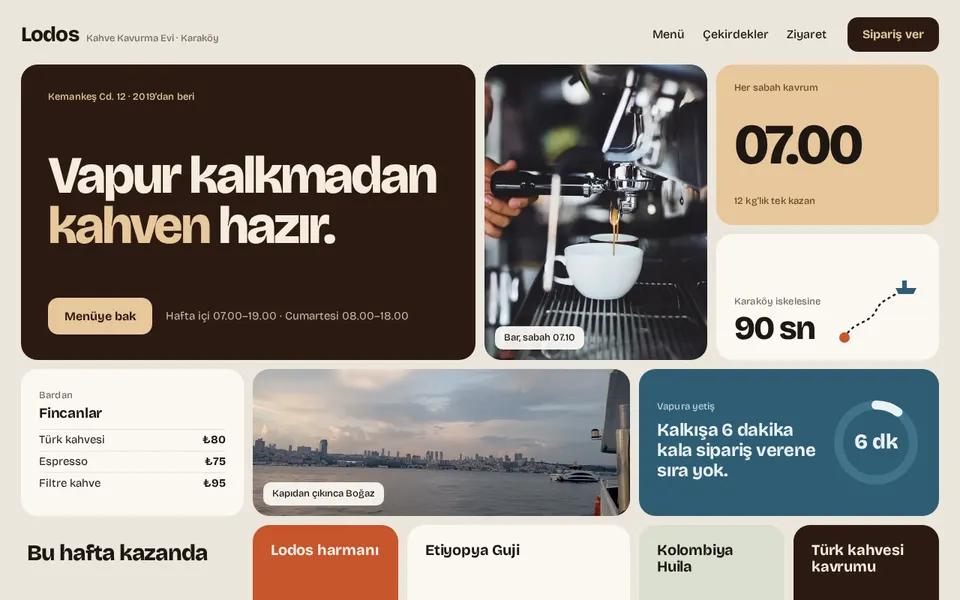

Demo: [`demos/styles/bento.html`](demos/styles/bento.html)

### Manga / anime paneli · Manga / anime panels

Panel kareleri, ekran tonu, hız çizgileri, konuşma balonları. Uyar: anime, oyun, genç kültür, yaratıcı kişisel site.

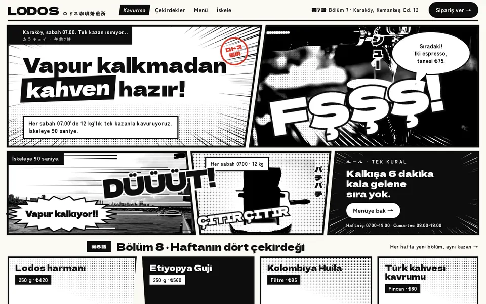

Demo: [`demos/styles/manga-panel.html`](demos/styles/manga-panel.html)

### Pop art / çizgi roman · Pop art / comic

Kalın kontur, Ben-Day noktaları, ses efekti yazıları, düz ana renkler. Uyar: eğlence, etkinlik, yiyecek.

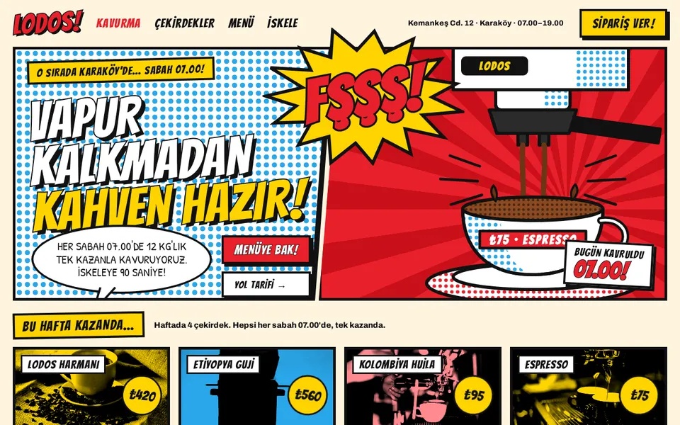

Demo: [`demos/styles/pop-art-comic.html`](demos/styles/pop-art-comic.html)

### İzometrik dünya · Isometric world

Her şey izometrik çizilmiş küçük bir dünyada; bina, araç, nesne. Uyar: teknoloji ürünü, şehir, süreç anlatımı.

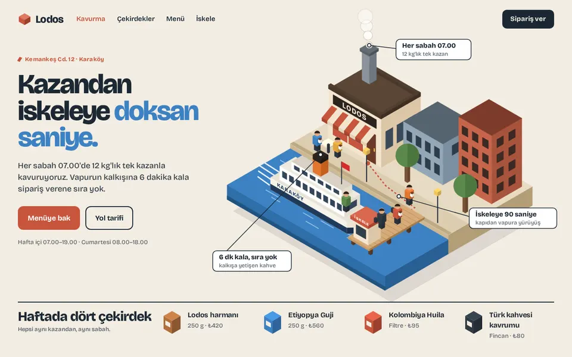

Demo: [`demos/styles/isometric-world.html`](demos/styles/isometric-world.html)

### 3D sahne · 3D scene

Derinlikli, dönen ya da içinde dolaşılan üç boyutlu bir sahne. Uyar: lansman, ürün, deneyim odaklı site.

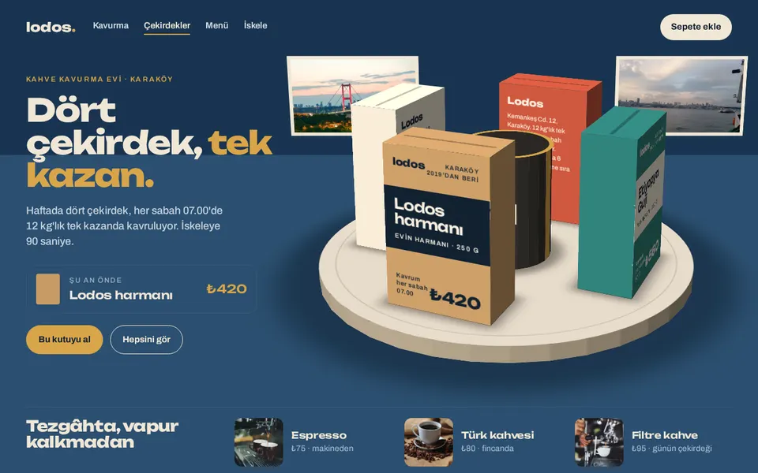

Demo: [`demos/styles/css3d-scene.html`](demos/styles/css3d-scene.html)

### Sonsuz tuval · Infinite canvas

Sayfa yerine sürüklenip keşfedilen geniş bir pano. Uyar: portfolyo, arşiv, yaratıcı stüdyo.

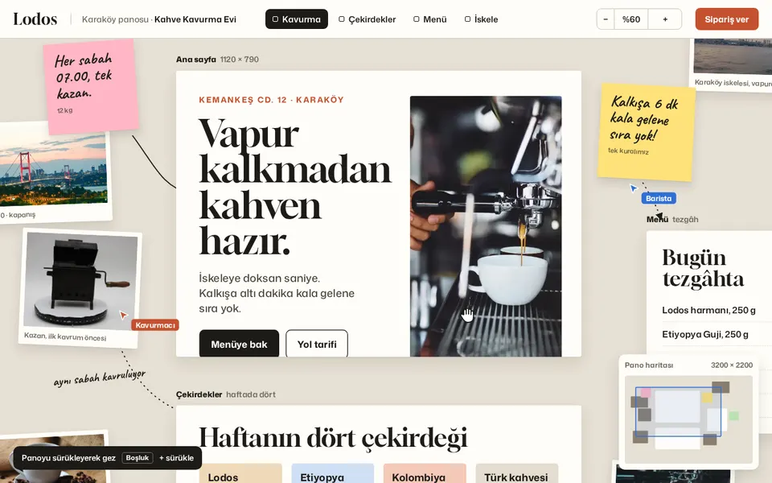

Demo: [`demos/styles/infinite-canvas.html`](demos/styles/infinite-canvas.html)

### Üretken sanat · Generative art

Koddan, veriden üretilen desenler sayfanın görseli olur. Uyar: teknoloji, veri, müzik, kişisel geliştirici sitesi.

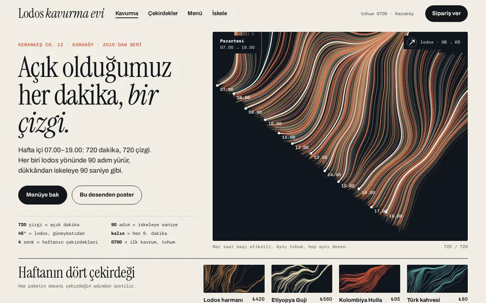

Demo: [`demos/styles/generative-art.html`](demos/styles/generative-art.html)

### Sinematik karanlık · Cinematic dark

Film afişi gibi; geniş kadraj, sinema yazısı, karanlık ve dramatik ışık. Uyar: otel, film, lansman, gece mekânı.

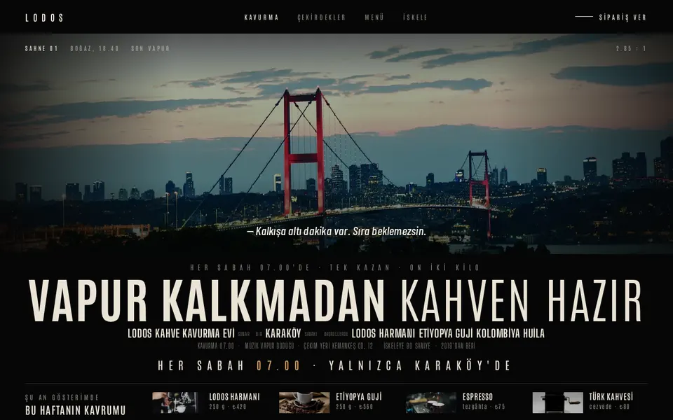

Demo: [`demos/styles/cinematic-dark.html`](demos/styles/cinematic-dark.html)

### Fotokopi fanzin · Xerox zine

Fotokopi lekesi, kesik yazılar, el yazısı notlar, punk enerji. Uyar: müzik, sanat, bağımsız mekân.

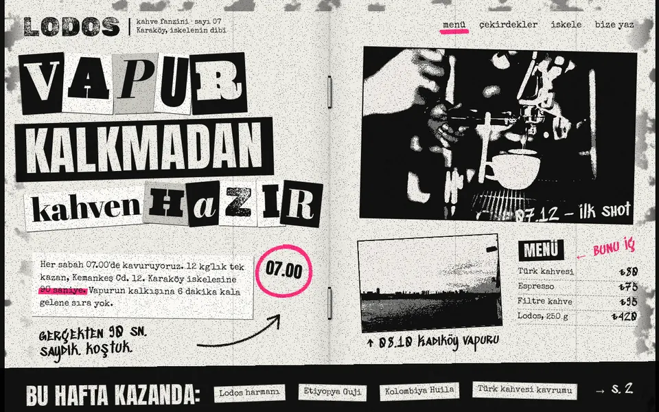

Demo: [`demos/styles/zine-xerox.html`](demos/styles/zine-xerox.html)

### Art deco · Art deco

Altın çizgiler, simetri, yelpaze motifleri, zarif uzun harfler. Uyar: otel, bar, mücevher, etkinlik.

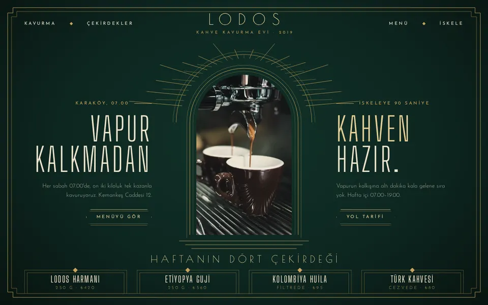

Demo: [`demos/styles/art-deco.html`](demos/styles/art-deco.html)

### Japon sadeliği · Japanese minimal (ma)

Boşluk (ma), dikey yazı, mühür kırmızısı, kâğıt dokusu. Uyar: seramik, çay, el işi, sakin markalar.

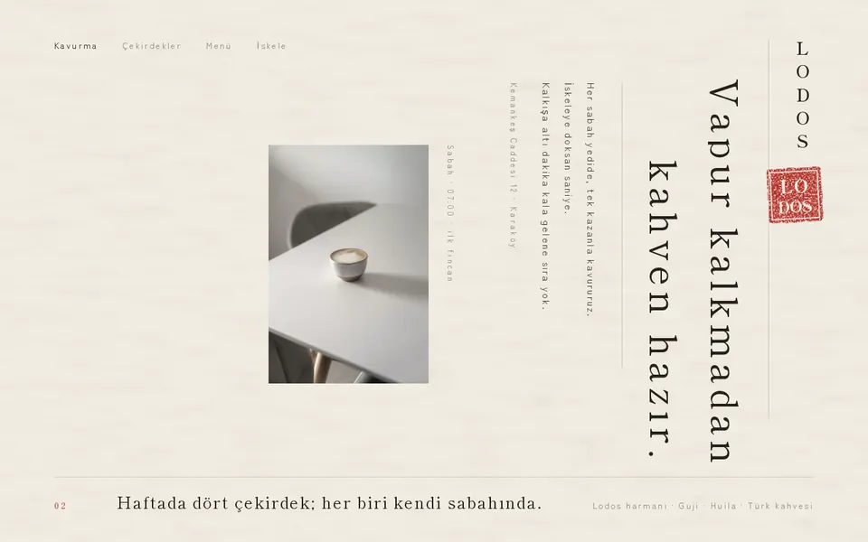

Demo: [`demos/styles/japanese-minimal.html`](demos/styles/japanese-minimal.html)

### Çıkartma kolajı · Sticker bomb

Üst üste yapıştırılmış çıkartmalar, rozetler, etiketler. Uyar: sokak kültürü, genç marka, etkinlik.

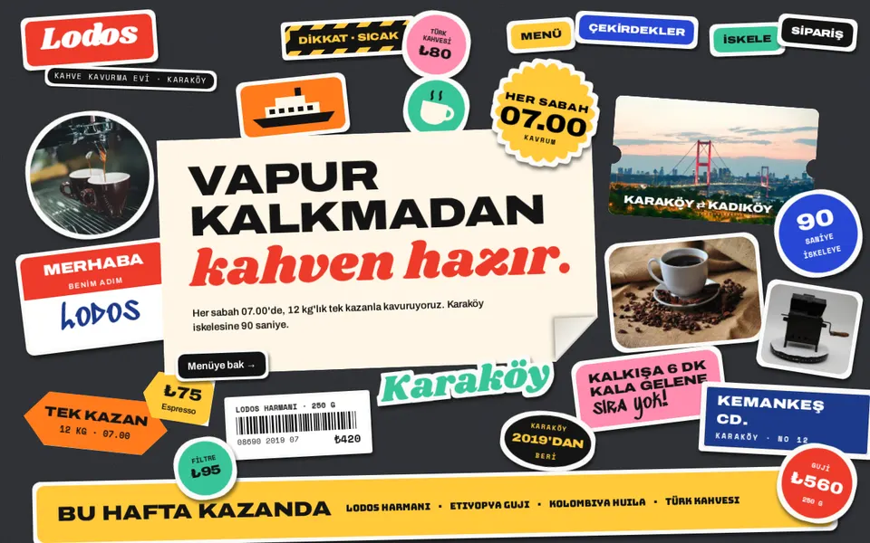

Demo: [`demos/styles/sticker-bomb.html`](demos/styles/sticker-bomb.html)

### Dijital bozulma · Glitch ⚠

Kayan kanallar, bozuk pikseller, sinyal kesintisi. Uyar: müzik, oyun, gece hayatı (kolay klişeleşir).

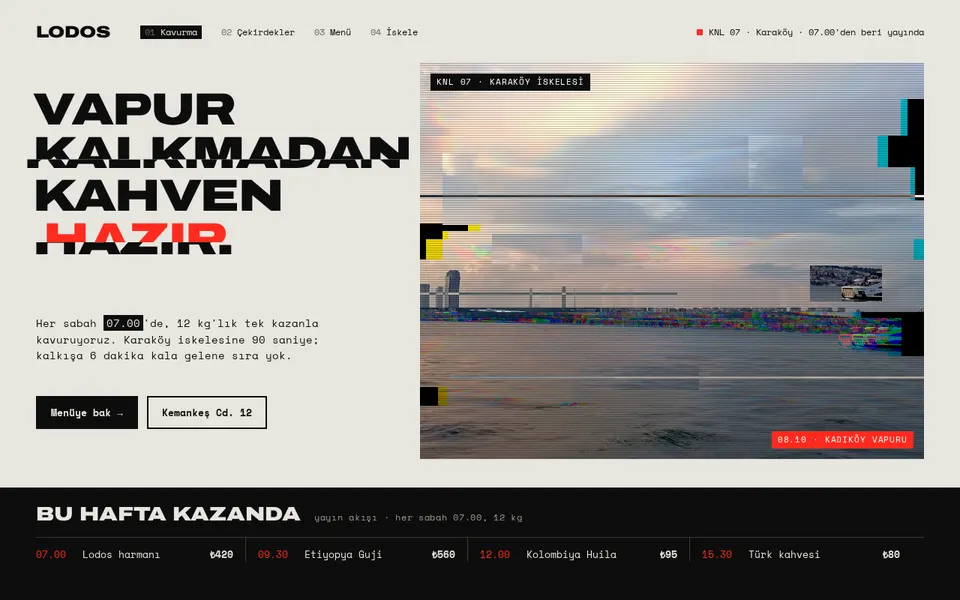

Demo: [`demos/styles/glitch.html`](demos/styles/glitch.html)

## Yazı hareketleri · Text motion

### Maskeli satır yükselişi · Line mask rise

Her satır kendi maskesinin arkasından yukarı kayar. Uyar: editoryal, uzun başlıklar. Araç: GSAP SplitText.

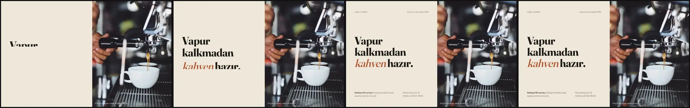

Demo: [`demos/text/line-mask-rise.html`](demos/text/line-mask-rise.html)

### Kaydırdıkça koyulaşan kelimeler · Word scrub

Okudukça kelimeler soluktan koyuya geçer. Uyar: manifesto, açıklama. Araç: SplitText + ScrollTrigger.

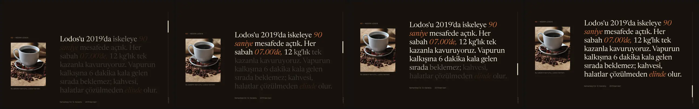

Demo: [`demos/text/word-scrub.html`](demos/text/word-scrub.html)

### Karışık harflerden çözülme · Scramble / decode

Rastgele karakterler gerçek yazıya oturur. Uyar: teknoloji, güvenlik, veri. Araç: GSAP ScrambleText.

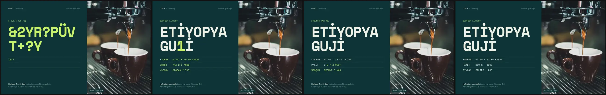

Demo: [`demos/text/scramble-decode.html`](demos/text/scramble-decode.html)

### Harf harf dökülme · Character cascade

Harfler kendi eğrisiyle tek tek gelir. Uyar: kısa büyük başlıklar. Araç: SplitText, Splitting.

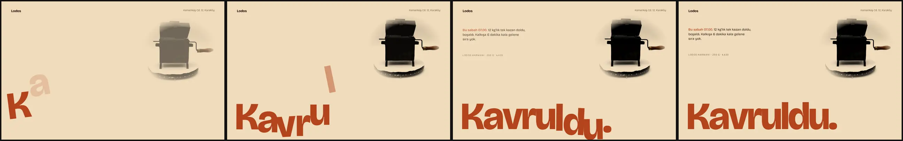

Demo: [`demos/text/char-cascade.html`](demos/text/char-cascade.html)

### Kalınlığı akan yazı · Variable-font morph

Yazının kalınlığı ve genişliği akıcı biçimde değişir. Uyar: tipografi odaklı, moda, müzik. Araç: değişken font + CSS.

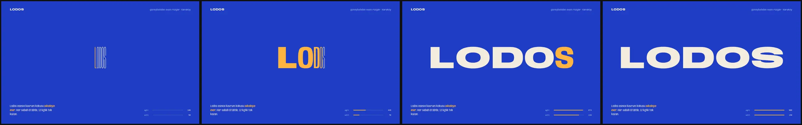

Demo: [`demos/text/variable-weight.html`](demos/text/variable-weight.html)

### Kinetik sekans · Kinetic sequence

Kelimeler büyüyüp üst üste binerek ekranı doldurur. Uyar: kampanya, etkinlik. Araç: GSAP timeline.

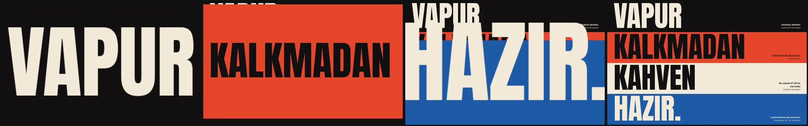

Demo: [`demos/text/kinetic-sequence.html`](demos/text/kinetic-sequence.html)

### Kalkış tabelası · Split-flap board

Harfler havalimanı tabelası gibi takır takır döner. Uyar: ulaşım, saat, canlı veri. Araç: CSS 3D.

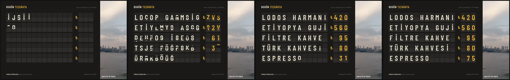

Demo: [`demos/text/split-flap.html`](demos/text/split-flap.html)

### Kendini yazan el yazısı · Handwriting draw

Çizgi kendini çizerek imza ya da kelime olur. Uyar: imza, kişisel marka. Araç: GSAP DrawSVG.

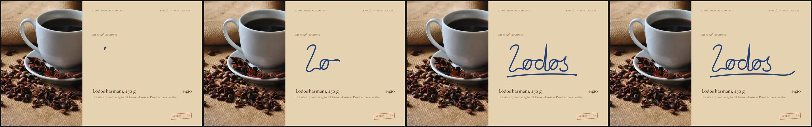

Demo: [`demos/text/handwriting-draw.html`](demos/text/handwriting-draw.html)

### Lastik yazı · Elastic type

Harfler esneyip yaylanarak yerine oturur. Uyar: eğlenceli marka, çocuk, etkinlik. Araç: yay fiziği, Motion.

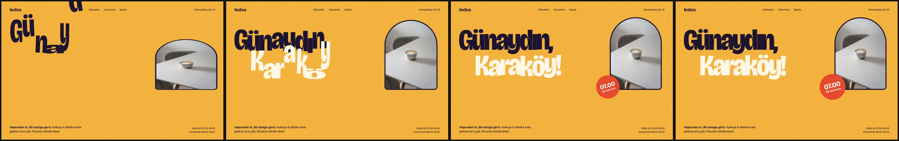

Demo: [`demos/text/elastic-type.html`](demos/text/elastic-type.html)

### Sayaç tekerleği · Odometer roll

Rakamlar mekanik sayaç gibi dönerek değişir. Uyar: fiyat, canlı veri, istatistik (gerçek sayılar). Araç: CSS.

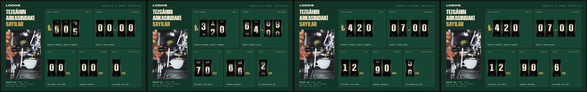

Demo: [`demos/text/odometer.html`](demos/text/odometer.html)

## Görselin oluşması · Image reveals and forming

Piksel, şerit, nokta ve maske ile görselin ekrana gelişi.

### Şeritlerden birleşme · Strip assemble

Görsel dikey şeritler halinde, sırayla ve ters yönlerden gelir. Uyar: mimarlık, holding, iç mekân. Araç: clip-path + GSAP.

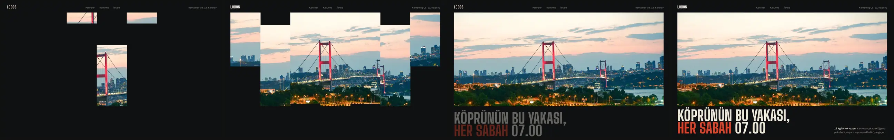

Demo: [`demos/forming/strip-assemble.html`](demos/forming/strip-assemble.html)

### Görselin logoya dönüşmesi · Shape morph to mark

Tam ekran görsel kaydırınca markanın şekline dönüşür. Uyar: marka açılışları. Araç: clip-path polygon + ScrollTrigger.

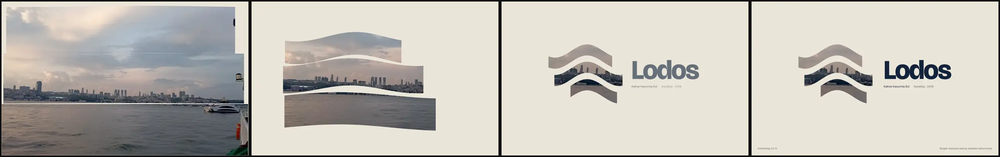

Demo: [`demos/forming/shape-morph-logo.html`](demos/forming/shape-morph-logo.html)

### Piksellerden netleşme · Pixel / mosaic resolve

Büyük bloklar küçülerek net görsele dönüşür. Uyar: dijital kültür, oyun, retro. Araç: canvas, OGL / three.

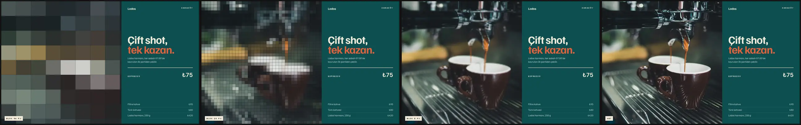

Demo: [`demos/forming/pixel-mosaic.html`](demos/forming/pixel-mosaic.html)

### Dither'dan açılma · Dithering reveal

1-bit nokta deseni tam tonlu görsele açılır. Uyar: karakterli teknoloji, baskı hissi. Araç: Paper Shaders, shader.

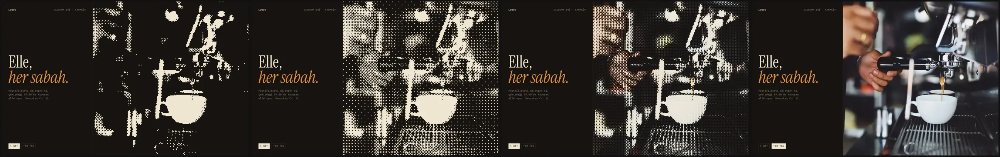

Demo: [`demos/forming/dither-reveal.html`](demos/forming/dither-reveal.html)

### Noktalardan oluşma · Halftone build

Görsel büyüyen baskı noktalarından oluşur. Uyar: baskı, müzik, afiş. Araç: Paper Shaders HalftoneDots.

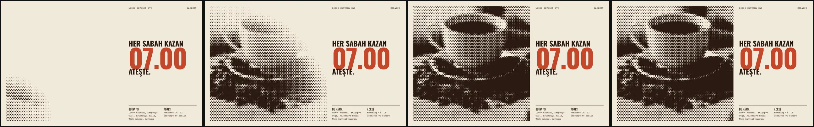

Demo: [`demos/forming/halftone-build.html`](demos/forming/halftone-build.html)

### Karakterlerden görsel · ASCII render

Görsel harf ve işaretlerden çizilir, sonra fotoğrafa döner. Uyar: yazılım araçları, arşiv. Araç: three AsciiEffect, canvas.

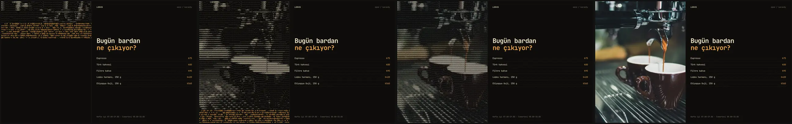

Demo: [`demos/forming/ascii-render.html`](demos/forming/ascii-render.html)

### Parçacıklardan toplanma · Particle assemble

Binlerce nokta uçuşup görselin şeklini alır. Uyar: lansman, bilim. Araç: three Points, OGL.

Demo: [`demos/forming/particle-assemble.html`](demos/forming/particle-assemble.html)

### Gürültüyle belirme · Noise dissolve

Görsel aşınarak, yanarak belirir. Uyar: film, parfüm, atmosfer. Araç: shader, vfx-js.

Demo: [`demos/forming/noise-dissolve.html`](demos/forming/noise-dissolve.html)

### Pencereden açılma · Iris / window expand

Küçük çerçeve büyüyüp tam ekran olur, görsel içinde küçülür. Uyar: vizyon, otel, açılış. Araç: clip-path inset + scale.

Demo: [`demos/forming/iris-expand.html`](demos/forming/iris-expand.html)

### Perde + ters hareket · Curtain + counter-parallax

Çerçeve aşağıdan açılırken içindeki görsel ters yöne kayar. Uyar: fotoğraf ağırlıklı her site. Araç: clip-path + GSAP.

Demo: [`demos/forming/curtain-parallax.html`](demos/forming/curtain-parallax.html)

### Fırça darbesiyle açılma · SVG mask wipe

Organik, fırça biçimli bir maske görseli açar. Uyar: el işi, yemek, illüstrasyon. Araç: SVG mask + GSAP.

Demo: [`demos/forming/svg-mask-wipe.html`](demos/forming/svg-mask-wipe.html)

### Sıvı geçiş · Liquid / displacement transition

İki görsel dalgalı bir bozulmayla birbirine karışır. Uyar: moda, galeri. Araç: WebGL shader, vfx-js.

Demo: [`demos/forming/liquid-transition.html`](demos/forming/liquid-transition.html)

### Bozulmalı geçiş · Glitch transition

Görsel kısa bir sinyal bozulmasıyla diğerine geçer. Uyar: müzik, oyun, teknoloji. Araç: canvas, CSS.

Demo: [`demos/forming/glitch-transition.html`](demos/forming/glitch-transition.html)

### Mürekkep yayılması · Ink bleed

Görsel kâğıda dökülen mürekkep gibi yayılarak belirir. Uyar: el işi, sanat, yemek. Araç: SVG filtre, canvas.

Demo: [`demos/forming/ink-bleed.html`](demos/forming/ink-bleed.html)

## Kaydırma ve sayfa geçişleri · Scroll and page transitions

### Sabitlenmiş hikâye · Pinned story

Bölüm sabit kalır, içerik kaydırmayla adım adım ilerler. Uyar: süreç, ürün anlatımı. Araç: ScrollTrigger pin + scrub.

Demo: [`demos/scroll/pinned-story.html`](demos/scroll/pinned-story.html)

### Üst üste yığılan paneller · Sticky stack

Paneller üst üste biner, alttaki küçülüp kararır. Uyar: hizmetler, adımlar, işler. Araç: position: sticky + scrub.

Demo: [`demos/scroll/sticky-stack.html`](demos/scroll/sticky-stack.html)

### Yatay ray · Horizontal rail

Aşağı kaydırınca bir şerit yana doğru ilerler. Uyar: zaman çizelgesi, portfolyo. Araç: ScrollTrigger containerAnimation.

Demo: [`demos/scroll/horizontal-rail.html`](demos/scroll/horizontal-rail.html)

### Küçülerek yerine oturan görsel · Scale-down hero

Tam ekran görsel küçülüp sayfadaki yerine yerleşir. Uyar: gayrimenkul, otel. Araç: ScrollTrigger, GSAP Flip.

Demo: [`demos/scroll/scale-down-hero.html`](demos/scroll/scale-down-hero.html)

### Çizgi çizilip sayı sayma · Rule draw + count

Çizgiler çizilir, gerçek sayılar değerine kadar sayar. Uyar: rakamlar (yalnız gerçek sayılar). Araç: GSAP.

Demo: [`demos/scroll/rule-draw-count.html`](demos/scroll/rule-draw-count.html)

### Yerine kayan düzen · FLIP layout

Filtrelenince öğeler yeni yerlerine akıcı biçimde kayar. Uyar: mağaza, galeri, filtre. Araç: GSAP Flip, Motion layout.

Demo: [`demos/scroll/flip-layout.html`](demos/scroll/flip-layout.html)

### Motifli sayfa geçişi · Motif page transition

Logodan gelen şekiller ekranı kapatıp yeni sayfayı açar. Uyar: marka odaklı siteler. Araç: GSAP + yönlendirici.

Demo: [`demos/scroll/motif-transition.html`](demos/scroll/motif-transition.html)

### Büyüyerek açılan kart · Shared-element transition

Küçük görsel büyüyüp bir sonraki sayfanın açılışı olur. Uyar: portfolyo, e-ticaret. Araç: View Transitions, Motion layoutId.

Demo: [`demos/scroll/shared-element.html`](demos/scroll/shared-element.html)

### Kaydırınca oynayan görüntü · Scroll-scrubbed sequence

Kaydırdıkça bir görüntü dizisi kare kare ilerler. Uyar: ürün tanıtımı, süreç. Araç: canvas görüntü dizisi, ScrollTrigger.

Demo: [`demos/scroll/video-scrub.html`](demos/scroll/video-scrub.html)

### 3D eğilen sayfa · 3D tilt on scroll

Kartlar ve görseller kaydırırken derinlikte eğilip döner. Uyar: portfolyo, ürün. Araç: CSS 3D, ScrollTrigger.

Demo: [`demos/scroll/tilt-3d-scroll.html`](demos/scroll/tilt-3d-scroll.html)

## Etkileşim · Interaction

### Mıknatıs buton · Magnetic control

Buton imlece doğru hafifçe çekilir. Uyar: ajans, eğlenceli marka. Araç: GSAP quickTo, Motion.

Demo: [`demos/interaction/magnetic.html`](demos/interaction/magnetic.html)

### İmleç izinde görseller · Cursor image trail

İmlecin geçtiği yerde görseller belirip kaybolur. Uyar: fotoğraf, moda. Araç: GSAP.

Demo: [`demos/interaction/cursor-trail.html`](demos/interaction/cursor-trail.html)

### Fırlatılabilen şerit · Drag with inertia

Sürükleyip bırakınca şerit savrulup yavaşça durur. Uyar: galeri, harita. Araç: GSAP Draggable + Inertia, Embla.

Demo: [`demos/interaction/drag-inertia.html`](demos/interaction/drag-inertia.html)

### Dokununca dalgalanan görsel · Hover distortion

İmleç gezdikçe görsel su gibi kıpırdar. Uyar: portfolyo (yalnız masaüstü). Araç: vfx-js, OGL.

Demo: [`demos/interaction/hover-distortion.html`](demos/interaction/hover-distortion.html)

### Fenerle keşif · Cursor mask reveal

İmlecin çevresinde alttaki ikinci görsel ya da metin açılır. Uyar: portfolyo, öncesi/sonrası. Araç: CSS mask, canvas.

Demo: [`demos/interaction/cursor-mask-reveal.html`](demos/interaction/cursor-mask-reveal.html)

### Büyüteç · Lens magnifier

İmlecin altı büyür, detaylar okunur. Uyar: ürün, harita, sanat. Araç: CSS, canvas.

Demo: [`demos/interaction/lens-magnifier.html`](demos/interaction/lens-magnifier.html)

### Karışan kart destesi · Card shuffle

Kartlar deste gibi karışıp öne çıkar. Uyar: işler, ürünler, ekip. Araç: GSAP, Motion.

Demo: [`demos/interaction/card-shuffle.html`](demos/interaction/card-shuffle.html)

### Sürüklenen sonsuz pano · Infinite drag grid

Her yöne sürüklenen, kenarı olmayan görsel panosu. Uyar: portfolyo, arşiv, galeri. Araç: GSAP Draggable, canvas.

Demo: [`demos/interaction/infinite-drag.html`](demos/interaction/infinite-drag.html)

## Görsel işleme · Image treatments

Farklı kaynaklardan gelen fotoğrafları tek bir sete çeviren işlemler.

### Çift ton · Duotone

Her fotoğraf markanın iki rengine çevrilir. Uyar: farklı kaynaklı fotoğrafları birleştirmek. Araç: CSS filter, ImageMagick.

Demo: [`demos/treatment/duotone.html`](demos/treatment/duotone.html)

### Film tonu + gren · Film grade + grain

Ortak renk tonu, hafif gren, aynı kontrast. Uyar: belgesel, otel, yemek. Araç: CSS, ImageMagick.

Demo: [`demos/treatment/film-grade.html`](demos/treatment/film-grade.html)

### Riso üst baskı · Riso overprint

İki mürekkep katmanı, hafif kayık baskı. Uyar: kafe, etkinlik, fanzin. Araç: CSS blend modes.

Demo: [`demos/treatment/riso-overprint.html`](demos/treatment/riso-overprint.html)

### Kesilmiş nesne · Cut-out object

Nesne zemininden ayrılıp renk alanı üstüne konur. Uyar: ürün, kolaj, menü. Araç: maske, PNG.

Demo: [`demos/treatment/cutout.html`](demos/treatment/cutout.html)

### Fotoğrafla dolu yazı · Type × image

Dev başlık fotoğrafın içinden kesilir ya da onu keser. Uyar: afiş hissi, kampanya. Araç: CSS background-clip, SVG mask.

Demo: [`demos/treatment/type-image-mask.html`](demos/treatment/type-image-mask.html)

