# Motion palette

The ghost moves one way: everything fades up 30 px when it scrolls into view. Ten sections, one
entrance, the same easing. It reads as a template even when every other choice is good.

Sites that feel crafted have a **motion language**: a small set of named moves, derived from the
subject, each used where it means something, and no two neighbouring sections arriving the same way.


<!-- gallery:start -->
## See them

Four frames of each move on the same demo client (live: `node scripts/gallery.mjs`; full list: `gallery/GALLERY.md`).

**Text motion**

<table>
<tr><td width="50%" valign="top">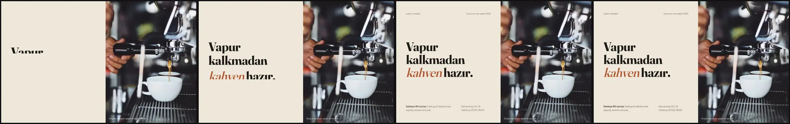<br><b>Line mask rise</b><br><sub>Maskeli satır yükselişi</sub></td><td width="50%" valign="top">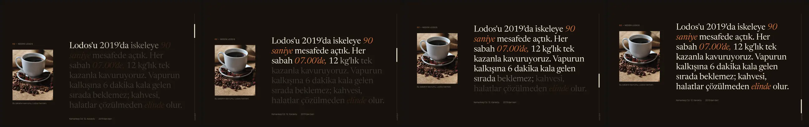<br><b>Word scrub</b><br><sub>Kaydırdıkça koyulaşan kelimeler</sub></td></tr>
<tr><td width="50%" valign="top">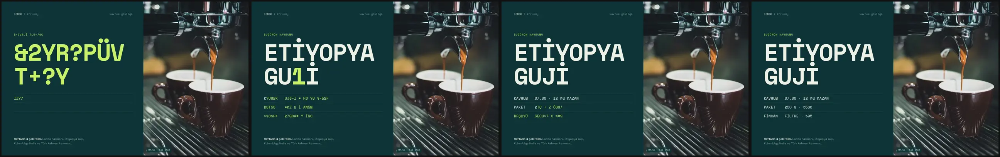<br><b>Scramble / decode</b><br><sub>Karışık harflerden çözülme</sub></td><td width="50%" valign="top">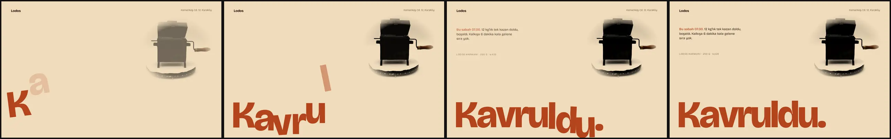<br><b>Character cascade</b><br><sub>Harf harf dökülme</sub></td></tr>
<tr><td width="50%" valign="top">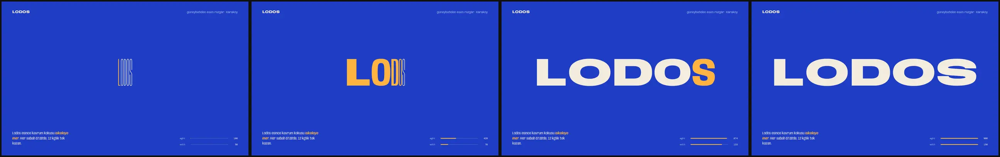<br><b>Variable-font morph</b><br><sub>Kalınlığı akan yazı</sub></td><td width="50%" valign="top">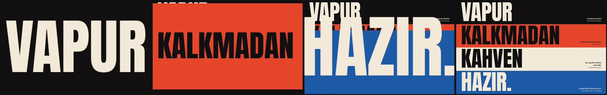<br><b>Kinetic sequence</b><br><sub>Kinetik sekans</sub></td></tr>
<tr><td width="50%" valign="top">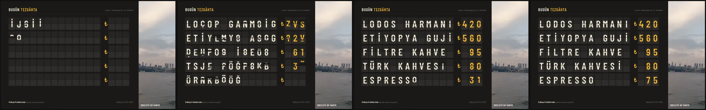<br><b>Split-flap board</b><br><sub>Kalkış tabelası</sub></td><td width="50%" valign="top">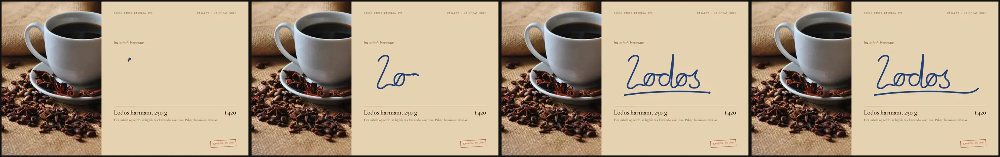<br><b>Handwriting draw</b><br><sub>Kendini yazan el yazısı</sub></td></tr>
<tr><td width="50%" valign="top">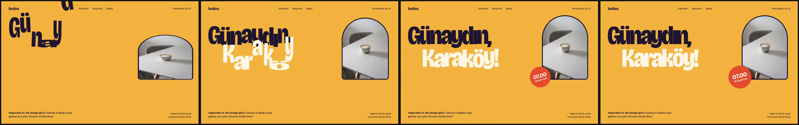<br><b>Elastic type</b><br><sub>Lastik yazı</sub></td><td width="50%" valign="top">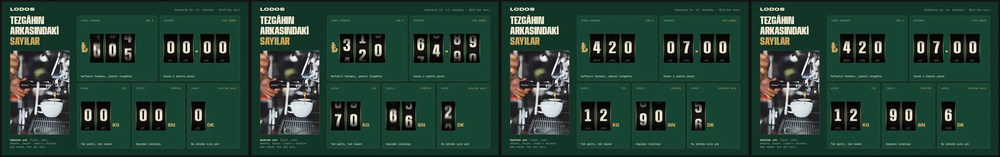<br><b>Odometer roll</b><br><sub>Sayaç tekerleği</sub></td></tr>
</table>

**Image reveals and forming**

<table>
<tr><td width="50%" valign="top">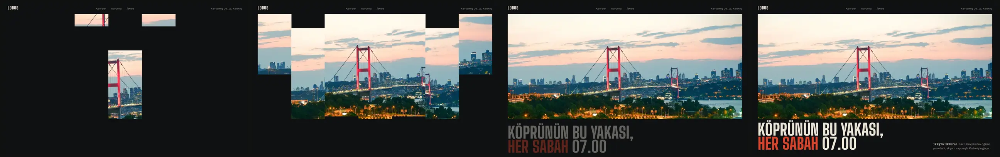<br><b>Strip assemble</b><br><sub>Şeritlerden birleşme</sub></td><td width="50%" valign="top">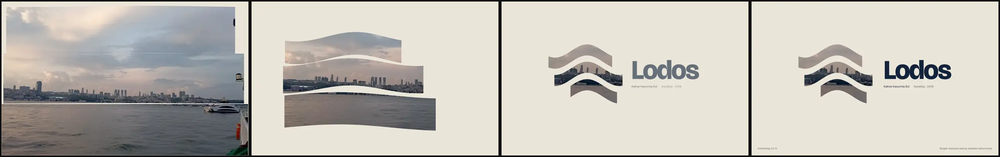<br><b>Shape morph to mark</b><br><sub>Görselin logoya dönüşmesi</sub></td></tr>
<tr><td width="50%" valign="top">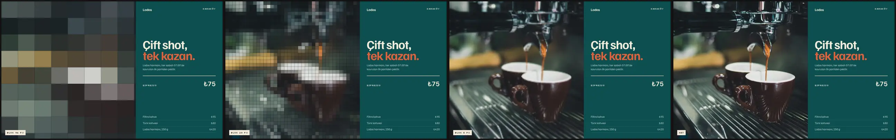<br><b>Pixel / mosaic resolve</b><br><sub>Piksellerden netleşme</sub></td><td width="50%" valign="top">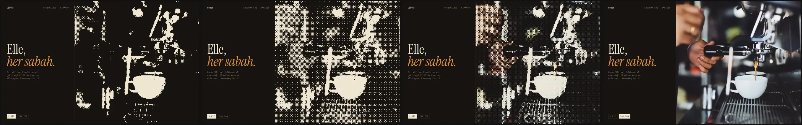<br><b>Dithering reveal</b><br><sub>Dither'dan açılma</sub></td></tr>
<tr><td width="50%" valign="top">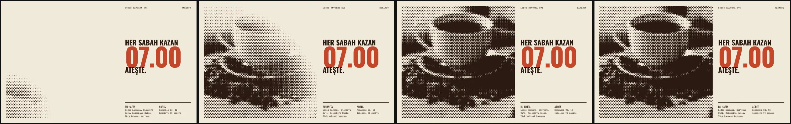<br><b>Halftone build</b><br><sub>Noktalardan oluşma</sub></td><td width="50%" valign="top">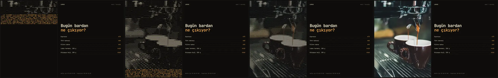<br><b>ASCII render</b><br><sub>Karakterlerden görsel</sub></td></tr>
<tr><td width="50%" valign="top">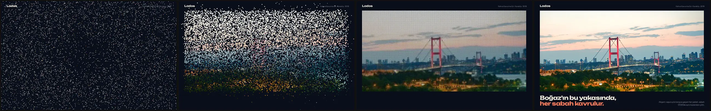<br><b>Particle assemble</b><br><sub>Parçacıklardan toplanma</sub></td><td width="50%" valign="top">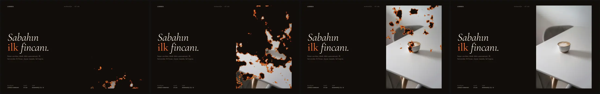<br><b>Noise dissolve</b><br><sub>Gürültüyle belirme</sub></td></tr>
<tr><td width="50%" valign="top">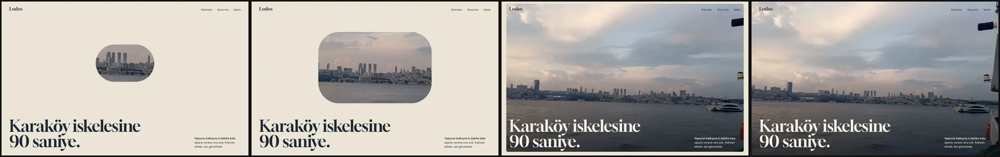<br><b>Iris / window expand</b><br><sub>Pencereden açılma</sub></td><td width="50%" valign="top">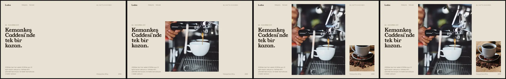<br><b>Curtain + counter-parallax</b><br><sub>Perde + ters hareket</sub></td></tr>
<tr><td width="50%" valign="top">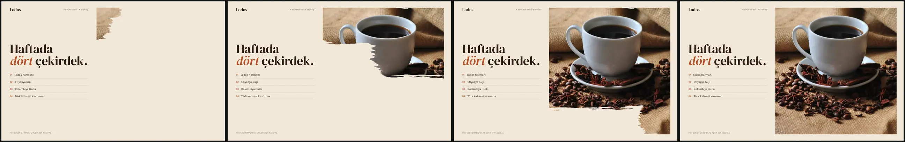<br><b>SVG mask wipe</b><br><sub>Fırça darbesiyle açılma</sub></td><td width="50%" valign="top">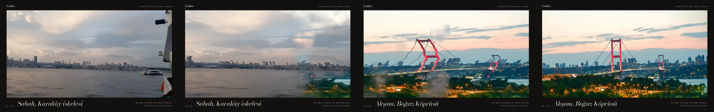<br><b>Liquid / displacement transition</b><br><sub>Sıvı geçiş</sub></td></tr>
<tr><td width="50%" valign="top">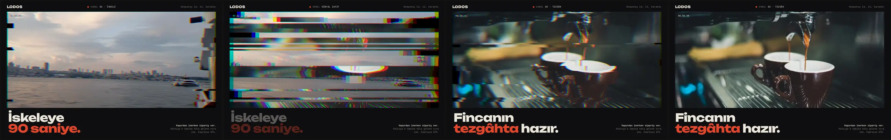<br><b>Glitch transition</b><br><sub>Bozulmalı geçiş</sub></td><td width="50%" valign="top">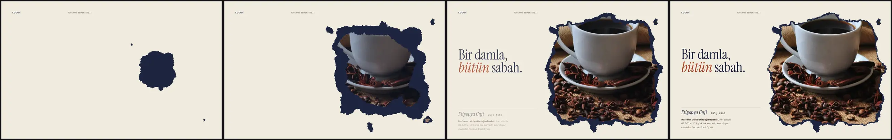<br><b>Ink bleed</b><br><sub>Mürekkep yayılması</sub></td></tr>
</table>

**Scroll and page transitions**

<table>
<tr><td width="50%" valign="top">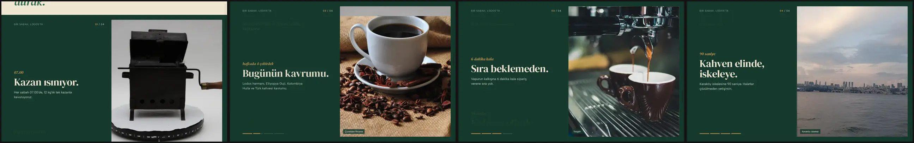<br><b>Pinned story</b><br><sub>Sabitlenmiş hikâye</sub></td><td width="50%" valign="top">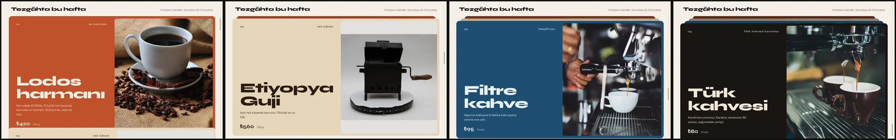<br><b>Sticky stack</b><br><sub>Üst üste yığılan paneller</sub></td></tr>
<tr><td width="50%" valign="top">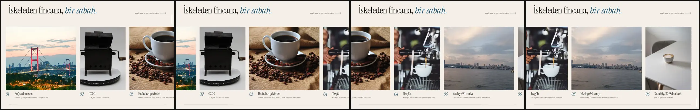<br><b>Horizontal rail</b><br><sub>Yatay ray</sub></td><td width="50%" valign="top">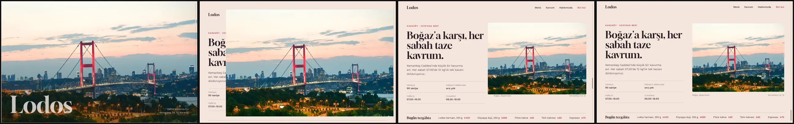<br><b>Scale-down hero</b><br><sub>Küçülerek yerine oturan görsel</sub></td></tr>
<tr><td width="50%" valign="top">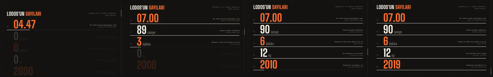<br><b>Rule draw + count</b><br><sub>Çizgi çizilip sayı sayma</sub></td><td width="50%" valign="top">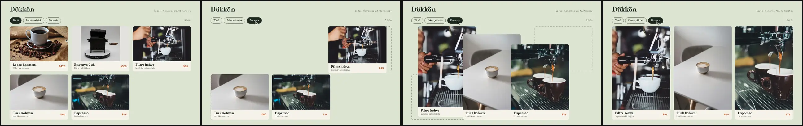<br><b>FLIP layout</b><br><sub>Yerine kayan düzen</sub></td></tr>
<tr><td width="50%" valign="top">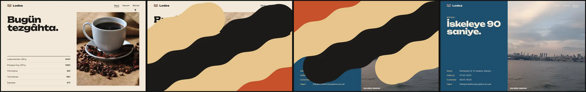<br><b>Motif page transition</b><br><sub>Motifli sayfa geçişi</sub></td><td width="50%" valign="top">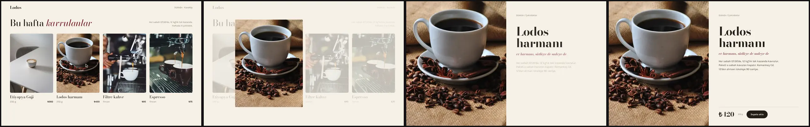<br><b>Shared-element transition</b><br><sub>Büyüyerek açılan kart</sub></td></tr>
<tr><td width="50%" valign="top">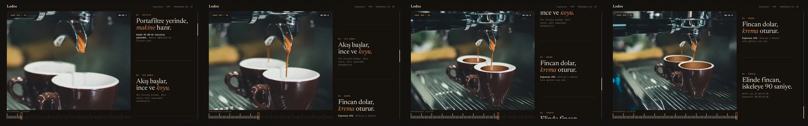<br><b>Scroll-scrubbed sequence</b><br><sub>Kaydırınca oynayan görüntü</sub></td><td width="50%" valign="top">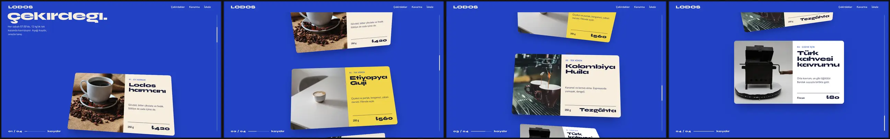<br><b>3D tilt on scroll</b><br><sub>3D eğilen sayfa</sub></td></tr>
</table>

**Interaction**

<table>
<tr><td width="50%" valign="top">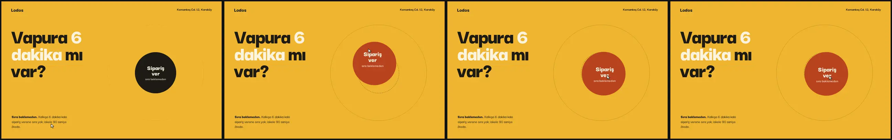<br><b>Magnetic control</b><br><sub>Mıknatıs buton</sub></td><td width="50%" valign="top">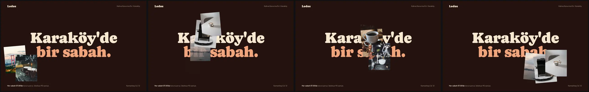<br><b>Cursor image trail</b><br><sub>İmleç izinde görseller</sub></td></tr>
<tr><td width="50%" valign="top">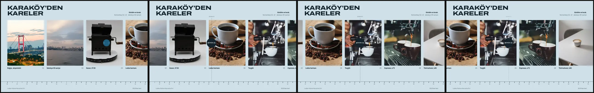<br><b>Drag with inertia</b><br><sub>Fırlatılabilen şerit</sub></td><td width="50%" valign="top">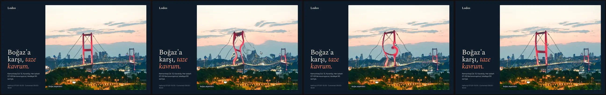<br><b>Hover distortion</b><br><sub>Dokununca dalgalanan görsel</sub></td></tr>
<tr><td width="50%" valign="top">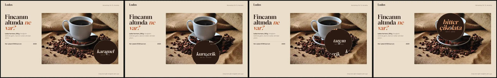<br><b>Cursor mask reveal</b><br><sub>Fenerle keşif</sub></td><td width="50%" valign="top">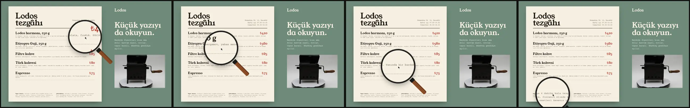<br><b>Lens magnifier</b><br><sub>Büyüteç</sub></td></tr>
<tr><td width="50%" valign="top">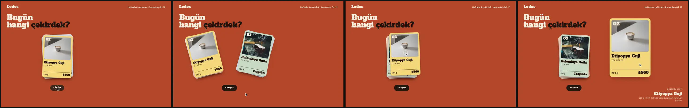<br><b>Card shuffle</b><br><sub>Karışan kart destesi</sub></td><td width="50%" valign="top">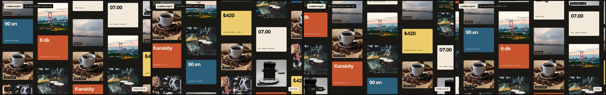<br><b>Infinite drag grid</b><br><sub>Sürüklenen sonsuz pano</sub></td></tr>
</table>

**Image treatments**

<table>
<tr><td width="50%" valign="top">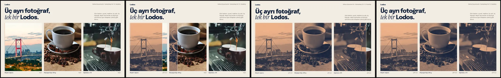<br><b>Duotone</b><br><sub>Çift ton</sub></td><td width="50%" valign="top">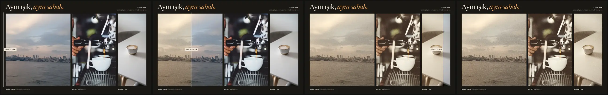<br><b>Film grade + grain</b><br><sub>Film tonu + gren</sub></td></tr>
<tr><td width="50%" valign="top">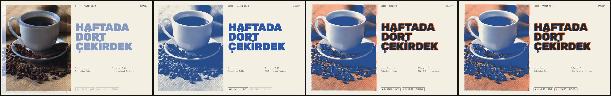<br><b>Riso overprint</b><br><sub>Riso üst baskı</sub></td><td width="50%" valign="top">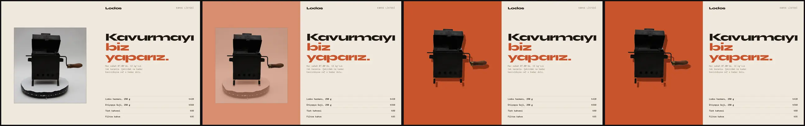<br><b>Cut-out object</b><br><sub>Kesilmiş nesne</sub></td></tr>
<tr><td width="50%" valign="top">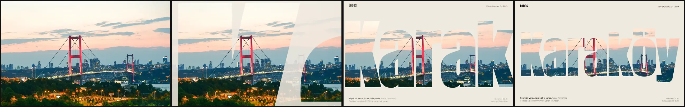<br><b>Type × image</b><br><sub>Fotoğrafla dolu yazı</sub></td></tr>
</table>

<!-- gallery:end -->

## 1. Build a motion language, not a list of effects

Take the shape for the motion from the subject or the brand mark, then reuse it everywhere.

> **Worked example (a holding company site).** The logo is five vertical bars. The same five
> bars become the preloader (they grow from the centre out), the page transition (five strips
> cover the screen, centre first), the menu opening, and the hero image, which is cut into five
> columns that slide in alternately up and down and then **morph into the logo shape** while the
> hero is pinned on scroll. Nothing is literally made of pixels, but the page feels like it
> assembles itself out of pieces, because one motif does all the moving.

Write the language into `DESIGN.md`:

```
Motion motif: <the shape/material it comes from> (5 logo bars / route line / dough fold / PCB layers)
Signature move: <one, used once or twice, the thing people remember>
Supporting moves: <2–4, from the catalog below, each with where it's used>
Shared grammar: <stagger order (centre-out, edge-in, random, along a path), 2 named easings, duration range>
Page transition: <how pages change>
Reduced motion: <what each move becomes>
```

Shared grammar is what makes varied moves still feel like one site: the same stagger order, the
same two easings (e.g. `expo.inOut` for wipes, `power4.out` for text), the same "container clips
while the inner image counter-moves and settles from scale 1.15–1.35".

## 2. Rules

1. **One signature move per project**, plus 2–4 supporting moves. More than that is a demo reel.
2. **No two adjacent sections share an entrance.** Plan it as a sequence, e.g.:
   hero (pinned morph) → statement (word scrub) → numbers (rule draw + count) → services (sticky
   stack) → vision (iris expand) → work (horizontal rail) → footer.
3. **Inner pages reuse 3 primitives** (e.g. line reveal, image curtain, quiet fade) and vary them
   with props: direction, delay cascade, stagger order. Don't invent new effects per page.
4. **Motion explains or rewards.** A morph that turns the photo into the logo says "this is who
   we are"; a scrub that darkens words as you read paces a manifesto. If you can't say what a move
   means, cut it.
5. **The page works without it.** Real text stays in the DOM (`aria-label` on the original,
   `aria-hidden` on split spans). Every move has a `prefers-reduced-motion` version (final state or
   a plain cross-fade). Hide pre-animation state only when JS + motion are on (`.js [data-reveal]`),
   never with a bare `opacity:0` in CSS.
6. **Don't hijack scroll.** Pinned sections advance with native scroll; smooth scroll (Lenis) must
   keep anchors, find-in-page and keyboard scrolling working.
7. **Pick a different signature next project.** Record it in `DESIGN-LOG.md`; repeating last
   project's signature is your own ghost.
8. **Watch the person's rejections.** Horizontal shine/sweep, glow trails and ambient blobs are
   common rejections. Prefer vertical, centre-out or shaped wipes over a left-to-right shine.

## 3. Catalog

Difficulty: **S** an afternoon · **M** a day or two · **L** WebGL-heavy.
⚠ = slides easily into a common rejection; use only with a reason.

### Text
| Move | What you see | Tool | D | Fits |
|---|---|---|---|---|
| Line mask rise | each line slides up from behind its own mask | GSAP SplitText `mask:"lines"`, anime.js `splitText` | S | editorial, long headlines |
| Word scrub | words go from faint to full as you scroll past | SplitText + ScrollTrigger `scrub` | S | manifestos, statements |
| Set-type drop | words drop in with a slight rotation, like set type | SplitText, Motion | S | brand statements |
| Character cascade | letters arrive on a custom curve | SplitText, Splitting | S | short display words |
| Scramble / decode | random glyphs settle into the real text | GSAP ScrambleTextPlugin | S | tech, security, data |
| Typed with corrections | types, backspaces, retypes | GSAP TextPlugin | S | dev tools, conversational products |
| Variable-font morph | weight/width change with scroll, cursor or proximity | `font-variation-settings` + GSAP/Motion | S | type-led, fashion, music |
| Kinetic sequence | words scale, stack and fill the viewport on a timeline | GSAP timeline | M | campaigns, events, music |
| Text on a path | type runs along a curve tied to the subject | SVG `textPath` + GSAP | S | food, craft, routes |
| Split-flap board | characters flip like a departures board | CSS 3D, Rive | M | transport, time, live data |
| Handwriting draw | an SVG stroke writes itself | GSAP DrawSVGPlugin | S | signatures, personal brands |
| Glyph/logo morph | one shape morphs into another | GSAP MorphSVGPlugin | M | logo intros, transitions |
| Elastic type | letters stretch and spring into place | spring physics, Motion | S | playful brands, events |
| Odometer roll | digits roll like a mechanical counter | CSS | S | prices, live data (real numbers only) |

### Image and media: "forming from pieces"
| Move | What you see | Tool | D | Fits |
|---|---|---|---|---|
| Strip assemble / blinds | image arrives in staggered strips, alternating directions | `clip-path` per strip + GSAP | S | architecture, holdings, interiors |
| Shape morph on scroll | full image morphs into the brand mark (polygon clip-paths) | interpolated `clip-path: polygon()` in a pinned scrub | M | brand openers |
| Pixel / mosaic resolve | big blocks resolve down to a sharp image | shader (OGL/three), canvas; React Bits "pixel transition" | M | games, digital culture, retro |
| Dithering reveal | 1-bit Bayer pattern resolves to full tone | `@paper-design/shaders-react` ImageDithering, custom shader | M | tech with character, print-like |
| Halftone build | image forms from dots (optionally CMYK) | Paper Shaders HalftoneDots/HalftoneCMYK | M | print, music, posters |
| ASCII render | image or 3D scene drawn in characters | three `AsciiEffect`, React Bits ASCII text | M | dev tools, archives |
| Particle assemble | thousands of points fly into the image's shape | three `Points`, OGL | L | launches, science |
| Noise dissolve | image burns or erodes in through noise | shader, vfx-js | M | film, fragrance, mood |
| Liquid / displacement transition | two images blend through a warp map | three/OGL shader, vfx-js, curtainsjs | L | fashion, galleries |
| Iris / window expand | small framed window grows to full bleed while the image scales down | `clip-path: inset()` + scale, scrubbed | S | vision statements, hospitality |
| Curtain + counter-parallax | container opens from one edge while the inner image moves the other way | `clip-path: inset()` + inner `yPercent` | S | any photo-led site |
| SVG mask wipe | organic/brush-shaped mask reveals the image | SVG `<mask>` + GSAP | M | craft, food, illustration |
| Scale-down hero | full-bleed media shrinks into its place in the layout | ScrollTrigger, GSAP Flip | S | real estate, hospitality |
| Slit-scan | time-smeared strips of video | canvas/shader with frame history | L | art, experimental video |
| Hover distortion | image ripples or bulges under the cursor | vfx-js, OGL | M | portfolios (desktop only) |
| RGB split ⚠ | colour channels separate for a moment | vfx-js, postprocessing | S | music, nightlife; reads "cyber" fast |
| Glitch transition ⚠ | a short signal break between two images | canvas, CSS | S | music, games |
| Ink bleed | the image spreads in like ink on paper | SVG turbulence mask, canvas | M | craft, art, food |

### Layout and scroll
| Move | What you see | Tool | D | Fits |
|---|---|---|---|---|
| Pinned story | section holds while its content advances with scroll | ScrollTrigger `pin`+`scrub`, Motion `useScroll` | M | process, product explainers |
| Sticky stack | panels stack; the one beneath scales to ~0.92 and darkens | `position:sticky` + scrubbed scale | S | services, case studies, steps |
| Horizontal rail | vertical scroll drives a sideways track (desktop) | ScrollTrigger `containerAnimation` | M | timelines, portfolios |
| Zoom-through | camera pushes through an element into the next scene | ScrollTrigger scale, three camera | M | immersive openers |
| Rule draw + count | lines draw in, real numbers count to value | GSAP scaleX + tweened text | S | stats (only real numbers) |
| FLIP layout | items glide to new positions on filter/sort | GSAP Flip, Motion `layout`, AutoAnimate | S | shops, galleries, filters |
| View transitions | native morph between pages or states | `document.startViewTransition`, `view-transition-name` | S | any multi-page site |
| Shared-element page change | a thumbnail grows into the next page's hero | View Transitions, Motion `layoutId`, Barba/Swup | M | portfolios, e-commerce |
| Motif page transition | strips/shapes from the brand mark cover and uncover the page | GSAP + router intercept | M | brand-led sites |
| Scroll-driven CSS | progress and reveals with no JS | `animation-timeline: view()` | S | lightweight sites |
| Velocity skew | content skews slightly with scroll speed | Lenis velocity + GSAP | S | editorial, galleries |
| Scroll-scrubbed sequence | a frame sequence advances with scroll | canvas image sequence + ScrollTrigger | M | product, process |
| 3D tilt on scroll | cards and images tilt in depth while scrolling | CSS 3D + ScrollTrigger | S | portfolios, products |

### Interaction and ambient
| Move | What you see | Tool | D | Fits |
|---|---|---|---|---|
| Magnetic control | button leans toward the cursor | GSAP `quickTo`, Motion springs | S | playful, agency |
| Cursor image trail | images spawn and fade along the cursor path | GSAP; Codrops image-trail demos | M | photography, fashion |
| Drag with inertia | a track or canvas you can throw | GSAP Draggable + Inertia, Embla | M | galleries, maps (keyboard alternative) |
| Physics toys | objects fall, collide, can be grabbed | GSAP Physics2D, Matter.js | M | playful brands, events |
| Cursor mask reveal | a circle around the cursor reveals a second image or text | CSS mask, canvas | S | before/after, portfolios |
| Lens magnifier | a round lens enlarges what's under the cursor | CSS, canvas | S | products, maps, art |
| Card shuffle | a deck shuffles and one card comes forward | GSAP, Motion | S | work, products, team |
| Infinite drag board | an edgeless board of images dragged in any direction | GSAP Draggable, canvas | M | portfolios, archives |
| State-machine characters | icons/mascots react to input | Rive | M | apps, onboarding |
| Data-driven canvas | generative image from real data (tide, traffic, sales) | p5.js, canvas, OGL | M | civic, science, logistics |
| Flow field | particles follow a noise field | p5.js, three | M | art, research |
| Mesh gradient ⚠ | slowly moving colour field | Paper Shaders MeshGradient | S | basically the ambient blob |
| No-code shader scenes ⚠ | animated WebGL backgrounds | Unicorn Studio, Spline | S | most templates are glow, blobs or grids |

## 4. Libraries (checked on npm 2026-11-20; run `npm view <pkg> version` before installing)

**Default stack:** `gsap` + `@gsap/react` (Next/React or vanilla), `lenis` for smooth scroll,
`motion` for React layout/gesture work, `@paper-design/shaders-react` or `ogl` for image
treatments, native View Transitions for page changes.

| Package | Version · license | For |
|---|---|---|
| `gsap` · `@gsap/react` | 3.15.1 · 2.1.2, GSAP Standard License | timelines, ScrollTrigger, Flip, Draggable. **All former paid plugins are free** (SplitText, ScrambleText, MorphSVG, DrawSVG, Inertia, Physics2D), commercial use OK. Not open source: it can't be used in no-code animation builders that compete with Webflow. |
| `motion` | 14.14.0, MIT | framer-motion's new name; `motion/react`, layout animations, gestures |
| `lenis` | 1.3.27, MIT | smooth scroll; drive it from `gsap.ticker` |
| `animejs` | 4.5.0, MIT | lighter GSAP alternative; v4 has `splitText`, `onScroll`, draggable |
| `@react-spring/web` | 10.1.2, MIT | spring physics |
| `@formkit/auto-animate` | 0.10.2, MIT | zero-config list FLIP |
| `splitting` | 1.1.0, MIT | text split into CSS-variable spans |
| `@barba/core` · `swup` | 2.10.3 · 4.10.0, MIT | page transitions for multi-page (non-SPA) sites |
| `embla-carousel-react` | 8.6.0, MIT | headless carousel with drag physics (prefer over Swiper's default look) |
| `three` · `@react-three/fiber` · `@react-three/drei` | 0.187.0 · 9.8.2 · 10.7.9, MIT | 3D/WebGL; three addons include `AsciiEffect` |
| `postprocessing` | 6.39.6, Zlib | pixelation, noise, chromatic aberration passes |
| `ogl` | 1.0.11, Unlicense | minimal WebGL, far smaller than three |
| `pixi.js` | 8.23.0, MIT | 2D WebGL/WebGPU sprites, filters, displacement |
| `@paper-design/shaders-react` | 0.0.82, npm says Apache-2.0 (check the repo LICENSE) | dithering, image dithering, halftone, many ready shaders; playground at shaders.paper.design |
| `@vfx-js/core` · `react-vfx` | 1.6.0 · 1.0.7, MIT | WebGL effects on img/video/text, custom GLSL |
| `curtainsjs` · `gpu-curtains` | 8.1.6 · 0.17.4, MIT | WebGL planes mapped to DOM images (gpu-curtains is WebGPU, still WIP) |
| `@rive-app/react-canvas` | 4.40.0, MIT | interactive state-machine animation |
| `@lottiefiles/dotlottie-react` | 0.22.3, MIT | After Effects animations (`.lottie`) |
| `@theatre/core` | 0.7.2, Apache-2.0 (studio is AGPL) | visual timeline editing; repo quiet since 2024 |
| `p5` | 2.4.0, LGPL-2.1 | generative / creative coding |

Spline (`@splinetool/react-spline`) and Unicorn Studio are hosted tools with their own terms; the
free Unicorn plan is non-commercial. Check before using them for a client.

## 5. Component kits: mechanics yes, looks no

Kits are where the "AI site" look comes from. Read them for **how** an effect works; never ship
their default tokens, and never use the components in the left column.

| Kit | License | Don't use (the AI signature) | Worth studying |
|---|---|---|---|
| Aceternity UI | free tier unclear; Pro commercial | spotlight, beams, meteors, sparkles, aurora/lamp, background grids, gradient text | sticky-scroll reveal, parallax hero scroll |
| Magic UI | MIT (Pro proprietary) | shimmer button, border beam, shine border, grid/dot pattern, meteors, particles, animated gradient text | number ticker (real numbers only), text-animate |
| React Bits | MIT + Commons Clause | aurora, galaxy, glare hover, shiny text | split text, decrypted text, variable-proximity text, pixel transition, ASCII text, dither, image trail, magnet |
| Motion Primitives | MIT | text shimmer, spotlight | text effect, text morph, morphing dialog, transition panel |
| Animata, Cult UI | MIT | animated beams, glossy cards | split-reveal preloader; check each piece |
| shadcn/ui | MIT | the default look itself (slate, one radius, `Card` everywhere) | accessible primitives; always restyle tokens |

The scanner flags the left-column names (`kit-slop`).

## 6. Interaction with personality (checked 2026-11-26)

Component sets and effect engines whose controls *react*: a press squashes, a toggle bursts, a
success has a sound. Unlike the kits in §5, the personality is the point. Use one where the
subject and the target feeling ask for it (playful, anime, game, comic, craft), keep it to the
interactive moments, and restyle colours through their variables. Check reduced motion,
keyboard use and real devices yourself: most of these are young.

**Anime / comic / physical feel**

| Library | Get it | License | What it does | Watch out |
|---|---|---|---|---|
| **sakuga-vfx** | github.com/finktheartist/sakuga-vfx · demo sakuga-vfx.vercel.app · `npx shadcn add finktheartist/sakuga-vfx/<name>` or copy the file + `<script>` (no npm package) | MIT | dependency-free web components (button, toggle, slider, checkbox, radio, input, tabs, progress, rating, toast, tooltip) that play anime impact frames: squash/stretch springs, speed lines, bursts, smoke rings, ドン!-style sound words, all on one shared canvas; colours via `--sk-*` | very new (Nov 2026, few commits), tested only in headless Chromium; the effect canvas sits on top (can cover modals/sticky headers), `overflow:hidden` parents clip it; toggle file is ~500 KB, others ~45 KB; reduced motion turns effects off |
| **Jelly UI** | github.com/jelly-org/ui · jelly-ui.com (script include, no npm name) | MIT | ~40 web components with soft-body physics: they wobble and spring like jelly | single maintainer, 2026 |
| **react-manga-effects** | npm `react-manga-effects` | MIT | manga focus/speed lines, iris-wipe transitions | early (0.1.x) |
| **KABOOM! UI** | github.com/Gorupa/kaboom-ui-kit | MIT | pure CSS comic book: ink frames, offset CMYK shadows, halftone | tiny project; keep halftone off full-page backgrounds |
| **mo.js** | npm `@mojs/core` | MIT | burst, shape and spring engine: build your own impact moment (the custom route to a sakuga feel) | last release 2023; design your own shapes, avoid stock sparkles |

**Whole component sets with character** (shadcn-compatible unless noted; checked 2026-11-26)

| Library | Demo · get it | License | What it feels like | Watch out |
|---|---|---|---|---|
| **Bevel** | bevel-ui.vercel.app · github.com/hiteshbandhu/bevel | MIT | 50 skeuomorphic parts modelled on real objects: keycap buttons, lever toggles, latch checkboxes, car-radio preset tabs, detent knobs, DIP switches, split-flap board, stamp, ticket, receipt | very new; check the "lamp" parts for glow |
| **audio-ui** | audio-ui.dev · ouestlabs/audio-ui | MIT | studio hardware: knobs, faders, XY pad, rocker switches, needle meters, LCDs; headless core for React/Vue/Svelte/web | keep spectrum/waveform colours off neon |
| **Tactile UI (free part)** | github.com/cipriantitire/tactile-ui-free | MIT | vanilla mechanical parts: odometer, compass, pull-cord bulb, engraved plates (paid kit has 190+) | small free set |
| **Looseleaf** | kevintngo.github.io/looseleaf · kevintngo/looseleaf | MIT (code, drawings, font) | 123 shadcn components drawn by hand on paper, same props as shadcn (swap without touching JSX), stickers, doodles, a mascot, reduced-motion + RTL | the most complete hand-drawn set |
| **Sketchbook UI** | sarthakrawat-1.github.io/sketchbook-ui · npm `sketchbook-ui` | MIT | 20 wobbly pencil-and-paper React components | — |
| **NeoBrutalism / neobrutalism.dev** | neobrutalism.com · neobrutalism.dev (ekmas/neobrutalism-components) | MIT | thick outlines, hard shadows, buttons that shift when pressed; theme builder | skip their bento and "AI" blocks |
| **1st-Pouf** | 1st-pouf.worksonmy.dev | MIT | claymorphic pastel kit, buttons sink when pressed | skip the dashboard/CRM templates (fake dashboard) |
| **React95** | react95.github.io/React95 | MIT (Windows art is Microsoft's) | full Windows 95 component set for React | easily becomes a costume |
| **Pixelore** | pixelore-ui.vercel.app · RPG demo pixelore-rpg.vercel.app | MIT | 8-bit design system: heart bars, battle screen, inventory, save slots | tiny project |
| **Fancy Components** | fancycomponents.dev · danielpetho/fancy | MIT | playful motion: letter swap, variable-font proximity, scramble, text along path, gravity (physics), elastic line, gooey and pixelate filters | skip "animated gradient with SVG"; pixel trail with care |
| **Animate UI** | animate-ui.com | MIT + Commons Clause | spring-animated tabs, switches, accordions (the primitives are the good part) | skip background effects and shimmering/gradient text |
| **SmoothUI**, **Skiper UI**, Unlumen UI | smoothui.dev · skiper-ui.com · ui.unlumen.com | MIT / mixed / MIT | Motion-based component collections, scroll effects, interactive cards | pick piece by piece |
| Kokonut UI ⚠, Eldora UI ⚠, Uiverse ⚠ | kokonutui.com · eldoraui.site · uiverse.io | MIT | Magic-UI-style collections / community buttons | mostly shimmer, gradient text, particles, neon: avoid by default |

**Animated icons:** lucide-animated (lucide-animated.com, MIT, React + ports), AnimateIcons
(animateicons.in, MIT, React/Vue/Angular/vanilla), itshover (itshover.com, Apache-2.0). Low risk;
use for icons that react on hover/press instead of static icon tiles.

**3D UI:** pmndrs/uikit (flexbox UI inside a React Three Fiber scene; skip its glass/visionOS kit),
Threlte (Svelte 3D), Matter.js (physics engine behind "falling/gravity" UIs).

**Hand-drawn**

| Library | Get it | License | What it does | Watch out |
|---|---|---|---|---|
| **Rough Notation** | npm `rough-notation` | MIT | hand-drawn underline, circle, highlight drawn live over real text | none; a great "meaningful motion" for editorial and craft |
| **Rough.js** | npm `roughjs` | MIT | sketchy shapes on canvas/SVG: make your own frames and illustrations | — |
| **Wired Elements** | npm `wired-elements` | MIT | sketch-style web components, slightly different each render | last code 2021, still RC |
| DoodleCSS, PaperCSS | chr15m.github.io/DoodleCSS · npm `papercss` | MIT / ISC | hand-drawn borders on plain HTML | alone they drift into the dry, monochrome look: pair with real colour and images |

**Retro / pixel / OS**

| Library | Get it | License | What it does | Watch out |
|---|---|---|---|---|
| **NES.css** | npm `nes.css` | MIT | 8-bit frames, buttons, icons | — |
| **8bitcn/ui** | 8bitcn.com (shadcn registry) | MIT | accessible 8-bit components on shadcn, fits Next/React | — |
| **98.css**, system.css | npm `98.css`, `@sakun/system.css` | MIT | Windows 98 / classic Mac | — |
| XP.css ⚠, 7.css ⚠ | npm `xp.css`, `7.css` | MIT | Windows XP / 7 | XP has gradient title bars, 7 has Aero glass: both hit common rejections |
| **augmented-ui** | npm `augmented-ui` | BSD-2 | CSS cut-corner "mech" frames | don't pair it with neon glow |
| Arwes ⚠ | github.com/arwes/arwes | MIT | animated sci-fi frames, text decode, sounds | unmaintained, React 18 only, default look is neon glow + grid: reference only |

**Sound and haptics** (the layer sakuga-vfx doesn't have)

| Library | Get it | License | What it does | Watch out |
|---|---|---|---|---|
| **UI SFX** | uisfx.com · npm `uisfx` | code MIT, sounds CC0 | 78 semantic UI sound cues (success, level-up…) in 12 packs, synthesised with Web Audio | sound off by default; let people mute |
| **ZzFX** | npm `zzfx` | MIT | ~1 KB retro game sound synth | pixel/game sites |
| **use-sound** / **Howler** | npm `use-sound`, `howler` | MIT | play your own sound files (React hook / engine) | — |
| **web-haptics** | npm `web-haptics` | MIT | mobile vibration presets (success, nudge, error) for React/Vue/Svelte/vanilla | iOS support relies on a workaround: test on a real phone |

**Bursts and particles ⚠** (`canvas-confetti`, `js-confetti`, `party-js`, `react-rewards`, `@tsparticles/engine`):
confetti and sparkle presets are the AI-site celebration cliché, and tsParticles' default node
network reads as an ambient background. Use only for one deliberate moment, with custom shapes
from the subject (beans, tickets, pixels), never as decoration.

## 7. Where to learn a move

- **Codrops** (tympanus.net/codrops): demos with source. Good starting points: free GSAP plugin
  demos (SplitText → MorphSVG, 2025), real-time dithering shader (2025), Bayer dithering
  backgrounds (2025), animating WebGL shaders with GSAP (2025), VFX-JS (2025), ASCII + dithering
  with WebGL (2026).
- **shaders.paper.design**: live playground for every Paper shader.
- **gsap.com** docs and showcase; **developer.chrome.com** for View Transitions.
